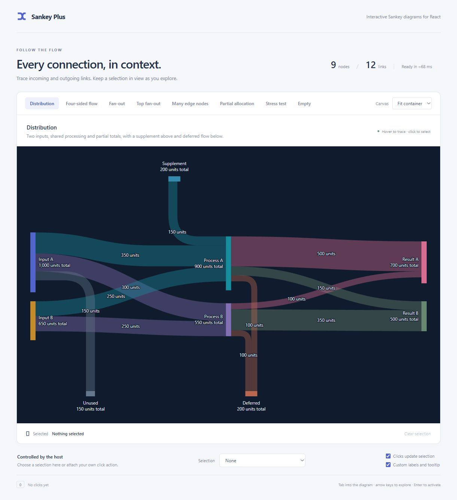
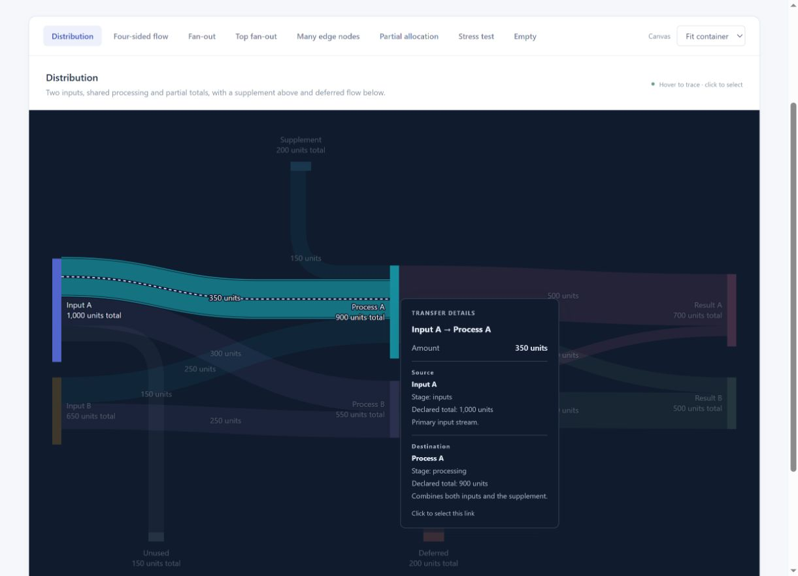
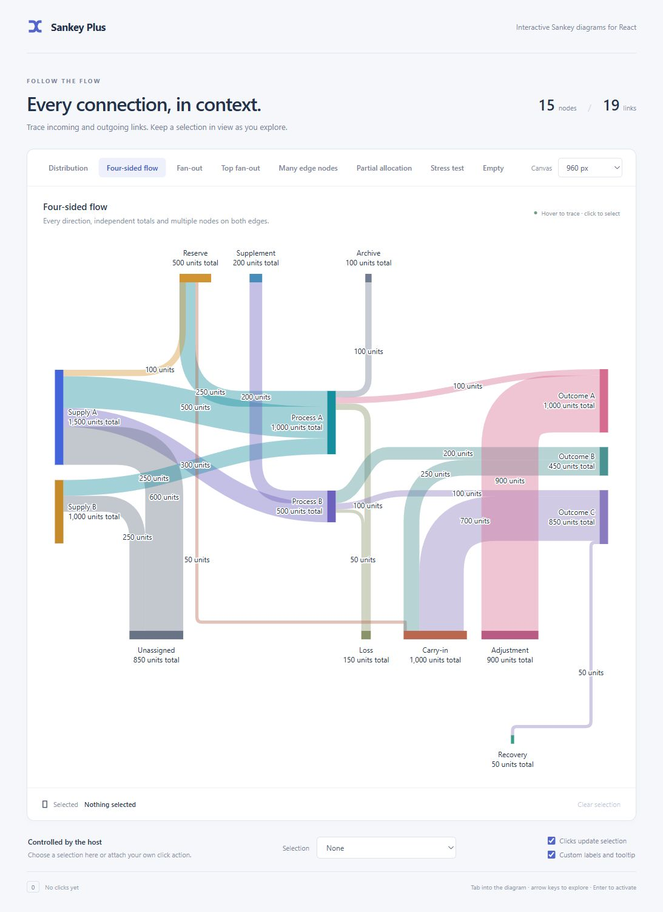

# Sankey Plus

`@bwin/sankey-plus` is an interactive React + TypeScript Sankey component with four-sided node placement, partial allocations and controlled selection. SVG drawing, layout, routing, hit testing and interactions are implemented in this package. Runtime dependencies are React and React DOM only.

The default Distribution demo combines two inputs, shared processing, partial totals, a supplement above, and unused/deferred flow below. Its nine nodes and twelve links use generic labels; the component has no business-domain logic.



## Installation

```sh
npm install @bwin/sankey-plus
```

Requires React and React DOM 18.2 or later. Import the component and its stylesheet:

```tsx
import { SankeyDiagram, type SankeyGraph } from '@bwin/sankey-plus';
import '@bwin/sankey-plus/style.css';
```

## Open the demo

The ZIP includes the compiled demo. With Node.js installed, preview it without installing packages:

```sh
node scripts/serve.mjs
```

Open **http://127.0.0.1:5178/**. The server binds only to the local machine. Set `PORT` to use another port.

All eight examples are directly available as tabs, including the **Stress test** with 100 nodes and 300 links. Left/Right arrows switch tabs; Home/End select the first/last example. The tabs wrap on narrow screens.

Beside the node/link counts, “Ready in ~… ms” shows approximate elapsed time from the demo update to a completed diagram and a paint opportunity. It includes chunk scheduling and frame waits, excludes downloads, and is not a CPU-only benchmark. Example, size and label changes refresh it; hover and selection do not. This observer belongs to the demo, with no extra library prop.

To develop from the GitHub repository:

```sh
git clone https://github.com/bwin/sankey-plus.git
cd sankey-plus
npm ci
npm run dev
```

The development command builds once and starts the server. After editing, run `npm run build` in another terminal and refresh the browser. There is no hot reload or file watcher.

```sh
npm run typecheck
npm test
npm run build
```

To measure layout performance:

```sh
npm run stress
npm run stress -- --runs 20 --output .tests/stress.json
npm run benchmark
npm run benchmark -- --case stress-100-300 --profile .tests/stress.cpuprofile
```

`stress` measures the deterministic **100-node / 300-link** fixture: four stages of 25 nodes, with four forward links per node to the next stage (indices wrap within that stage). Amounts are 10–13 units. `benchmark` also measures desktop/mobile regression fixtures, the four-sided example and wrapped fan-out. The shared generator is in `fixtures/stress.ts`.

Reports include the first calculation, median/min/max of ten subsequent calculations, scene dimensions, crossings and obstacle collisions. Timings cover data validation and layout at 1440 px for the stress case; compilation, React rendering and browser painting are excluded. CPU profiling adds overhead, so compare unprofiled runs for timings. [PERFORMANCE.md](PERFORMANCE.md) records the measured optimization results and limitations. These commands require a development checkout with dependencies installed; they are not included in the npm library.

The Stress test demo uses that same graph with the normal interactive renderer, custom two-line labels and responsive sizing. It grows vertically to fit all nodes; dense crossings are expected. Its layout can differ from the timing fixture because browser font measurement, container width and label settings affect geometry. Disable “Custom labels and tooltip” and select 1440 px in a sufficiently wide host for a closer visual comparison.

Node 22 was used for verification. React 19.2 was used for the demo; the library declares React/React DOM 18.2 or later as peer dependencies.

The working project has a local Git repository. Commit `23293a1` preserves the implementation before the demo-tab and interaction review; later commits record the changes separately. Use `git log --oneline` to inspect the history. Dependencies and generated builds are ignored. The downloadable ZIP contains source and compiled output, but not the local `.git` history.

## Integration

The packaged library is ESM and includes TypeScript declarations. Import its stylesheet separately. You can also copy `src/` into your application; its source entry already imports the stylesheet.

```tsx
import {useState} from 'react';
import {SankeyDiagram, type SankeyGraph, type SankeySubject} from '@bwin/sankey-plus';
import '@bwin/sankey-plus/style.css';

const graph: SankeyGraph = {
  stages: ['available', 'allocated'],
  nodes: [
    {key: 'source', title: 'Available', total: 1000, placement: {stage: 'available'}},
    {key: 'destination', title: 'Allocated', placement: {stage: 'allocated'}},
    {key: 'reserve', title: 'Reserve', total: 300, placement: {edge: 'top'}},
    {key: 'unused', title: 'Unallocated', placement: {edge: 'bottom'}},
  ],
  links: [
    {key: 'allocation', from: 'source', to: 'destination', amount: 500},
    {key: 'extra', from: 'reserve', to: 'destination', amount: 100},
    {key: 'remainder', from: 'source', to: 'unused', amount: 200},
  ],
};

export function Example() {
  const [selection, setSelection] = useState<SankeySubject | null>(null);
  return (
    <SankeyDiagram
      graph={graph}
      accessibleName="Allocation flow"
      selection={selection}
      onNodeClick={(facts, event) => {
        setSelection({kind: 'node', key: facts.node.key});
        // Original node + resolved quantities; event is a React activation event.
      }}
      onLinkClick={(facts) => {
        setSelection({kind: 'link', key: facts.link.key});
      }}
      formatAmount={(amount) => `${amount.toLocaleString()} units`}
    />
  );
}
```

Available retains a total of 1,000 while transferring only 700. Unconnected capacity stays visible; no link is invented for the remaining 300.

Keep inputs immutable and supply a new graph reference when data changes. Stable data and presentation callback references avoid unnecessary layout work. The host needs an actual available width; flex/grid parents should allow shrinking with `min-width: 0`.

The component computes layout on the main thread in cooperative chunks, targeting 8 ms of work before yielding through a timer task. Checkpoints are between layout phases, nodes, routes and comparisons; individual geometry helpers can exceed that target. Initial layout shows “Preparing diagram…” and sets `aria-busy`. A resize retains the last complete scene while the replacement is calculated. Changed inputs and unmounting cancel unfinished work, and only complete results are committed. No worker or bundler configuration is required. Validation, presentation callbacks and the final React/SVG render are still synchronous.

## Public interface

`src/types.ts` contains the full generic contract. Node and link metadata types are independent and retained in all callback contexts.

| Property | Purpose |
| --- | --- |
| `graph` | Ordered `stages`, `nodes` and `links` with stable keys. Required. |
| `accessibleName` | Descriptive accessible name for the diagram. Required. |
| `selection` | One `{kind: 'node' \| 'link', key}` or `null`. Fully controlled. |
| `onNodeClick` | Receives node facts and the activation event. |
| `onLinkClick` | Receives link facts and the activation event. |
| `formatAmount` | Formats quantities with facts, field name and surface. |
| `getLabel` | Returns plain text, up to two lines, or `null` to omit a label. |
| `renderTooltip` | Returns non-interactive React content or `null`. |
| `plotHeight` | Preferred central region height; default 336 CSS pixels. Edge bands add height. |
| `className` | Host styling, including the four theme tokens below. |

A node has `key`, `title`, and exactly one placement: `{stage: 'stage-key'}` or `{edge: 'top' | 'bottom'}`. It can have `total`, `color`, and `meta`. A link has `key`, `from`, `to`, and `amount`, plus optional `color` and `meta`.

Stages follow `graph.stages`. Node array order controls vertical order within a stage. All members of a stage have the same x coordinate, including when connections pass through top/bottom nodes. Empty stages are omitted. Link input order is a final tie-breaker after geometric ordering.

Quantities must be finite. Link amounts must be positive. A declared total must be non-negative and at least its incoming and outgoing sums independently. Without a declared total, the total is `max(incoming, outgoing)`. All quantitative bar lengths and ribbon widths share one scale. Incoming plus outgoing is never the required total for a relay.

Keys are unique within each kind. Parallel links need different keys. Invalid data, unknown endpoints, backward/same-stage links and directed cycles throw `SankeyInputError`. Its `issues` include diagnostic codes and affected keys. Mixed-role edge nodes must fit between their main-stage sources and targets. Use a host error boundary for invalid external data.

## Custom labels and tooltips

```tsx
<SankeyDiagram
  graph={graph}
  accessibleName="Allocation flow"
  formatAmount={(value, context) => {
    // context.field: total / incoming / outgoing / amount
    // context.surface: label / tooltip / accessible
    return `${value.toLocaleString()} units`;
  }}
  getLabel={(view) => view.kind === 'node'
    ? [view.node.title, `${view.text.total} total`]
    : view.text.amount
  }
  renderTooltip={(view) => view.kind === 'node' ? (
    <>
      <strong className="flow-tip-title">{view.node.title}</strong>
      <dl>
        <dt>Total</dt><dd>{view.text.total}</dd>
        <dt>Incoming</dt><dd>{view.text.incoming}</dd>
        <dt>Outgoing</dt><dd>{view.text.outgoing}</dd>
      </dl>
    </>
  ) : (
    <>
      <strong className="flow-tip-title">
        {view.fromNode.title} → {view.toNode.title}
      </strong>
      <span>{view.text.amount}</span>
    </>
  )}
/>
```

Labels use measured text, truncation and at most two lines. Link labels avoid bars and other labels; a label with no suitable space is hidden until its link is inspected. Tooltips and accessible descriptions retain the full information. Units are presentation only: there is no conversion or normalization of currencies/units.

For links, the tooltip context already includes both original nodes as `view.fromNode` and `view.toNode`, including their typed `meta`, `placement`, `color` and optional declared `total`. These are also available to label/amount formatters and `onLinkClick`. A missing `node.total` means it is derived; do not treat it as zero. The demo's custom link tooltip shows both endpoints, their placement, declared totals when present, and metadata notes. Try **Input A → Process A** in Distribution.



```tsx
// For a SankeyGraph<{ note: string }>, node metadata stays typed here.
renderTooltip={(view) => view.kind === 'link' ? (
  <>
    <strong>{view.text.amount}</strong>
    <p>From: {view.fromNode.title} — {view.fromNode.meta?.note}</p>
    <p>To: {view.toNode.title} — {view.toNode.meta?.note}</p>
  </>
) : <strong>{view.node.title}</strong>}
```

Tooltip placement, viewport clamping, dismissal and accessible association are internal. Content is portaled to `document.body` so it can escape the chart's scroll area. Interactive tooltip content is unsupported.

## Interaction and selection

- Inspecting a node keeps that node, all directly incoming/outgoing links, and every node those links touch strong. Everything else fades. This is one hop, not recursive traversal or all links between highlighted neighbors.
- Inspecting a link keeps only that link and its two endpoint nodes strong.
- Visible node and link labels activate their own subject. Node labels take priority over ribbons passing behind them; hidden labels do not create invisible click targets.
- Pointer movement inspects; leaving clears pointer inspection. Touch taps activate and pin details; dragging cancels activation. Tapping outside dismisses details.
- One roving tab stop enters the diagram. Arrow keys move through nodes then links in input order; Home/End jump to the ends. Enter/Space activate once. Escape dismisses inspection. Tab leaves normally.
- Keyboard focus works after pointer use, including clicks on empty chart space. Keyboard/touch details follow the inspected subject when resizing or scrolling changes its position.
- Activation calls the relevant handler. It never changes selection internally. The host may select, navigate, open a panel, or ignore the click.
- Selection uses a persistent solid outline in the selected node/link's own color, separated from its fill and surroundings by the surface color. The outline remains fully opaque when its fill fades during unrelated inspection. Keyboard focus uses a dashed indicator. Escape does not change selection. A selected key removed from the graph is ignored without a callback.

## Layout and routing

Top/bottom nodes are horizontal quantitative bars with full labels, facts and interactions. Both link directions use the inward face: below a top bar and above a bottom bar. Multiple edge nodes pack within their valid source/target intervals and wrap into rows. A side without nodes reserves no extra band.

Simple fan-out and fan-in use ordered ports. Bottom arrivals reverse vertical source order: a lower main source enters a shared bottom bar to the left of an upper source. Wrapped simple fan-out reserves separate vertical corridors and horizontal lanes. Row spacing grows with the combined ribbon widths and lane gaps, including unequal amounts and two-line labels. Destinations farther right turn closer to the preceding row; destinations farther left turn closer to their own row. This keeps their horizontal runs and connecting bends separate.

Inputs from edge nodes use their source bars' horizontal positions to order their destination slots. A detour needed for a wrapped row does not change that order: a rightmost bottom source still enters below its left-hand neighbor, with the mirrored rule for top sources.

Parallel wrapped links use a consistent 4 CSS-pixel gap on the vertical runs, around their shared turn and on the horizontal runs. The bends use shared centers and different radii so adjacent curves nest smoothly. Links still touch at their source ports; the first bend gradually opens the gap without changing ribbon widths or inflating the node's total. The group switches to these bends together when space and obstacle clearance allow it; constrained layouts retain the ordinary routing fallback.

When a main-stage link and a top/bottom link enter the same node, the main-stage curve can reach its final entry height earlier and finish horizontally. This prevents a late curve from crossing the vertical input and then crossing back again. The existing top/main/bottom port order stays intact. A bounded pass accepts the alternative only when sampled ribbon overlap decreases, no new crossing pair appears, and obstacle clearance does not worsen. It also checks for newly overlapping ribbon pairs, with a small tolerance for sampling noise and shared endpoints.

Complex graphs also use obstacle-aware paths and a bounded adjacent-port optimization. **Arbitrary graphs are not guaranteed to be crossing-free.** Main-stage order stays fixed. The implementation does not exhaustively reorder edge nodes or search every global layout. Dense, mixed or skipping-stage graphs can still contain crossings and overlapping ribbons. The supplied fixtures are checked for unrelated bar/label clearance.

Wrapping increases height. If stage spacing or an individual ribbon cannot clear obstacles at the available width, a wider internal canvas with a local horizontal scrollbar may be needed. Aggregate edge-node count alone does not force widening. Every resize starts from the current container width; expanding can remove rows and shrinking does not retain an old desktop minimum.

The chart creates a scroll container only when its canvas is wider than the host. Wheel input uses native browser scrolling and can continue to the surrounding page. Visual clipping uses `overflow: clip` without creating extra hidden scroll containers; no wheel handlers cancel or redirect input.

The routing search is bounded. Pathological custom graphs may still need a larger host container. There is no promise of a globally optimal layout or perfect clearance for every possible graph.

## Styling

The component inherits the font family, uses 12-pixel chart text, and exposes four theme tokens. Scope overrides on the component's class:

```css
.my-flow {
  --flow-surface: #ffffff;
  --flow-text: #24334a;
  --flow-muted-text: #68758b;
  --flow-focus: #2644af;
}
```

Provide `color` on nodes/links as needed. Otherwise nodes receive a stable palette color based on their key; links inherit their destination color. Unsupported CSS colors fall back to the palette. No application-specific theme provider is needed.

Distribution demonstrates a dark surface using these same tokens: `--flow-surface: #101b2d`, `--flow-text: #e4ebf6`, `--flow-muted-text: #a4b1c7` and `--flow-focus: #bac8ff`. The tooltip inherits the diagram's tokens even though it is portaled to the document body. Other examples retain their light surface.

## Source map

| File | Responsibility |
| --- | --- |
| `src/types.ts` | Public types and structured errors |
| `src/model.ts` | Validation, adjacency, totals, one-hop emphasis |
| `src/layout.ts` | Stage geometry, packing, ports and route allocation |
| `src/layout-task.ts` | Cooperative main-thread scheduling and cancellation |
| `src/paths.ts` | Curves, obstacle routing and hit-test geometry |
| `src/presentation.ts` | Quantity formatting and accessible descriptions |
| `src/SankeyDiagram.tsx` | Rendering, interactions, selection and tooltip |
| `src/style.css` | Appearance and theme tokens |
| `demo/fixtures.ts` | Generic examples and routing demonstrations |
| `demo/distribution.json` | Medium-complexity distribution example |
| `demo/feature-demo.json` | Full neutral example, including mixed-role edge nodes |
| `tests/core.test.ts` | Data, geometry and emphasis regressions |

`dist/` contains the compiled library, declarations and stylesheet. `demo-dist/` contains a self-contained browser build. Build/test scripts use TypeScript and Rollup in-process; no native compiler subprocess is needed.

## Actual implementation screenshots

These captures come from the running implementation, not design mockups.


Process A is inspected below while Unassigned remains externally selected. Its solid outline survives fading; Process A's keyboard focus indicator is dashed.


The mobile example wraps destinations into rows while keeping links separate.


With several destinations in each wrapped row, the horizontal lanes remain separate too. The row spacing includes the entire group of link widths. Nested bends keep the 4-pixel gaps consistent through the turn.


In this updated complete example, the two green inputs into Outcome B no longer cross each other. Process B reaches its upper entry height before Carry-in turns toward the lower entry. The same routing rule handles inputs from above.


Recovery keeps the bottommost incoming slot on Outcome C even when it wraps into a second bottom row.



See `VERIFICATION.md` for checks performed and verification limits.

## License

MIT. Copyright (c) 2026 Benjamin Winkler | bwin. See [LICENSE](https://github.com/bwin/sankey-plus/blob/main/LICENSE).
