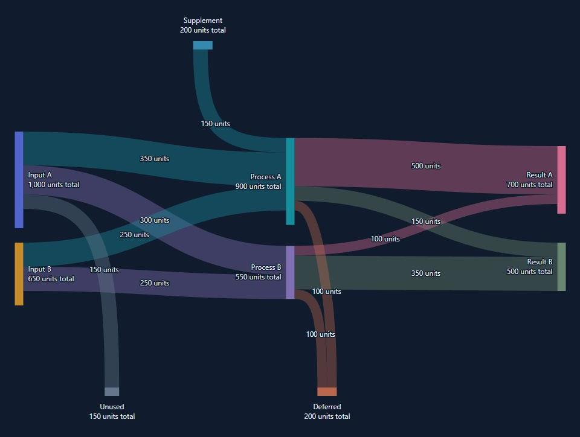

# Sankey Plus

**`@bwin/sankey-plus`** is an interactive React + TypeScript Sankey component with explicit stages, top/bottom nodes, independent totals and controlled selection. Runtime dependencies are React and React DOM only.

**[Live demo →](https://bwin.github.io/sankey-plus/)**

[Changelog](https://github.com/bwin/sankey-plus/blob/master/CHANGELOG.md)



## Quick start

```sh
npm install @bwin/sankey-plus
```

Requires React and React DOM 18.2 or later. The package is ESM and includes TypeScript declarations.

```tsx
import { SankeyDiagram, type SankeyGraph } from '@bwin/sankey-plus';
import '@bwin/sankey-plus/style.css';

const graph: SankeyGraph = {
  stages: ['input', 'output'],
  nodes: [
    {
      key: 'source',
      title: 'Available',
      total: 1000,
      placement: { stage: 'input' },
    },
    { key: 'target', title: 'Allocated', placement: { stage: 'output' } },
  ],
  links: [{ key: 'allocation', from: 'source', to: 'target', amount: 500 }],
};

export default function Example() {
  return (
    <SankeyDiagram
      graph={graph}
      accessibleName="Available and allocated amounts"
    />
  );
}
```

The source keeps its total of 1,000 while transferring only 500. Give the diagram a container with an available width.

## Features

- Ordered stage columns plus multiple top/bottom nodes, with wrapping on narrow canvases.
- One-hop hover highlighting, keyboard navigation, node/link clicks and externally controlled selection.
- Custom labels, tooltips with both connected nodes, typed metadata and light/dark theme tokens.
- Common value scaling and explicit totals larger than their connected transfers.

## Guides

| Guide                                                                                                    | Covers                                                                 |
| -------------------------------------------------------------------------------------------------------- | ---------------------------------------------------------------------- |
| [Getting started](https://github.com/bwin/sankey-plus/blob/master/docs/getting-started.md)               | Integration, click handlers, selection and sizing                      |
| [API reference](https://github.com/bwin/sankey-plus/blob/master/docs/api.md)                             | Props, graph data, stages, callback contexts and validation            |
| [Customization](https://github.com/bwin/sankey-plus/blob/master/docs/customization.md)                   | Labels, endpoint tooltips, formatting and themes                       |
| [Layout and interaction](https://github.com/bwin/sankey-plus/blob/master/docs/layout-and-interaction.md) | Routing, wrapping, hover, keyboard behavior and limits                 |
| [Examples](https://github.com/bwin/sankey-plus/blob/master/docs/examples.md)                             | What each interactive demo demonstrates                                |
| [Development](https://github.com/bwin/sankey-plus/blob/master/docs/development.md)                       | Local setup, tests, builds and stress commands                         |
| [Releasing](https://github.com/bwin/sankey-plus/blob/master/docs/releasing.md)                           | Changelog, dev → master, package verification, npm and GitHub releases |

Layout yields in main-thread chunks; individual helpers and SVG rendering can still block. Arbitrary graphs are not guaranteed to be crossing-free. See [performance](https://github.com/bwin/sankey-plus/blob/master/docs/performance.md) and [verification](https://github.com/bwin/sankey-plus/blob/master/docs/verification.md) for measurements and tested coverage. `master` contains the latest npm release; ongoing development happens on `dev`.

## Run the demo locally

```sh
git clone https://github.com/bwin/sankey-plus.git
cd sankey-plus
npm ci
npm run dev
```

Open [localhost:5178](http://127.0.0.1:5178/). After editing, run `npm run build` and refresh; there is no watcher.

## License

[MIT](LICENSE) · Copyright (c) 2026 Benjamin Winkler | bwin.
