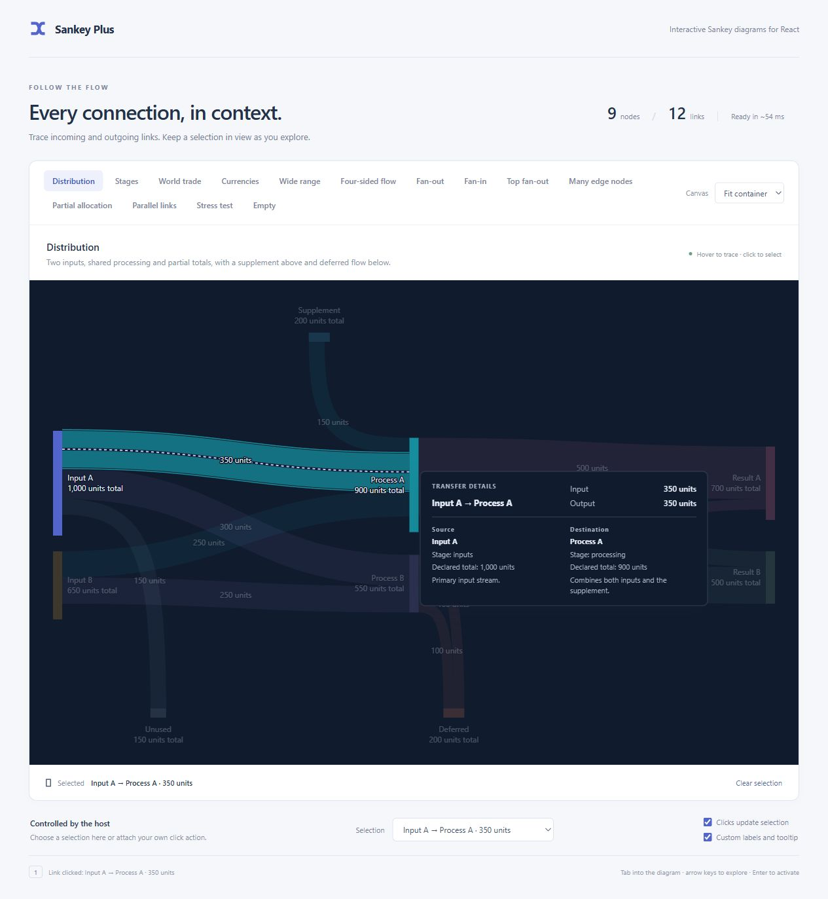

# Labels, tooltips and themes

[Back to README](../README.md)

## Labels and tooltips

Default labels, tooltips and accessible descriptions use the runtime locale. Pass a stable `formatAmount` callback when output must be identical on a server and in a browser with a different locale.

```tsx
<SankeyDiagram
  graph={graph}
  accessibleName="Allocation flow"
  formatAmount={(value, context) => {
    // context.field: total / incoming / outgoing / amount
    // context.surface: label / tooltip / accessible
    return `${value.toLocaleString()} units`;
  }}
  getLabel={(view) =>
    view.kind === 'node'
      ? [view.node.title, `${view.text.total} total`]
      : view.text.amount
  }
  renderTooltip={(view) =>
    view.kind === 'node' ? (
      <>
        <strong className="flow-tip-title">{view.node.title}</strong>
        <dl>
          <dt>Total</dt>
          <dd>{view.text.total}</dd>
          <dt>Incoming</dt>
          <dd>{view.text.incoming}</dd>
          <dt>Outgoing</dt>
          <dd>{view.text.outgoing}</dd>
        </dl>
      </>
    ) : (
      <>
        <strong className="flow-tip-title">
          {view.fromNode.title} → {view.toNode.title}
        </strong>
        <span>{view.text.amount}</span>
      </>
    )
  }
/>
```

Labels use measured text and horizontal truncation. Arrays retain all lines, including per-unit balances and a converted total; layout reserves additional vertical space for longer node labels. Link labels avoid bars and other labels; a label with no suitable space is hidden until its link is inspected. Tooltips and accessible descriptions retain the full information. See [units and conversion](units.md) for native amounts, converted widths, `text.totals`, `text.converted` and conversion-rate equations. Custom callbacks own their content: use those structured fields when showing a multi-unit node instead of only `text.total`.

For links, the tooltip context already includes both original nodes as `view.fromNode` and `view.toNode`, including their typed `meta`, `placement`, `color` and optional declared `total`. These are also available to label/amount formatters and `onLinkClick`. A missing `node.total` means it is derived; do not treat it as zero. The demo's custom link tooltip shows both endpoints, their placement, declared totals when present, and metadata notes. Try **Input A → Process A** in Distribution.



```tsx
// For a SankeyGraph<{ note: string }>, node metadata stays typed here.
renderTooltip={(view) => view.kind === 'link' ? (
  <>
    <strong>{view.text.amount}</strong>
    <p>From: {view.fromNode.title} — {view.fromNode.meta?.note}</p>
    <p>To: {view.toNode.title} — {view.toNode.meta?.note}</p>
  </>
) : <strong>{view.node.title}</strong>}
```

Tooltip placement, viewport clamping, dismissal and accessible association are internal. Content is portaled to `document.body` so it can escape the chart's scroll area. Interactive tooltip content is unsupported.

## Theme and colors

The component inherits the font family, uses 12-pixel chart text, and exposes four theme tokens. Scope overrides on the component's class:

```css
.my-flow {
  --flow-surface: #ffffff;
  --flow-text: #24334a;
  --flow-muted-text: #68758b;
  --flow-focus: #2644af;
}
```

Provide `color` on nodes/links as needed. Otherwise nodes receive a stable palette color based on their key; links inherit their destination color. Unsupported CSS colors fall back to the palette. No application-specific theme provider is needed.

Distribution demonstrates a dark surface using these same tokens: `--flow-surface: #101b2d`, `--flow-text: #e4ebf6`, `--flow-muted-text: #a4b1c7` and `--flow-focus: #bac8ff`. The tooltip inherits the diagram's tokens even though it is portaled to the document body. Other examples retain their light surface.

## Stable callbacks

Keep formatting and label callbacks stable (declare them outside the component or memoize them) when their behavior has not changed. New callback identities can trigger presentation/layout work. See [getting started](getting-started.md) and the [API reference](api.md).
