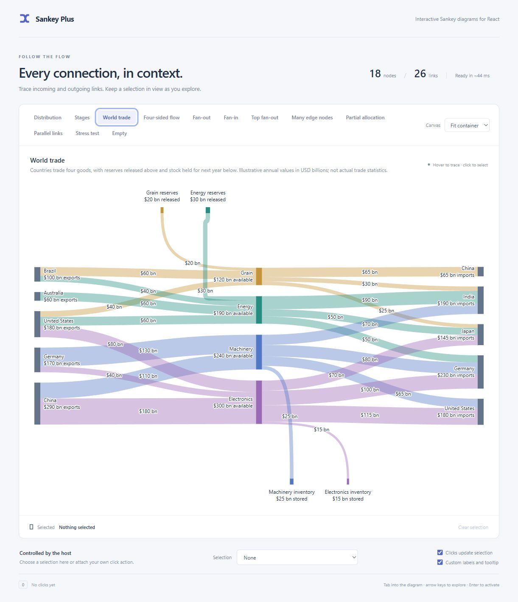
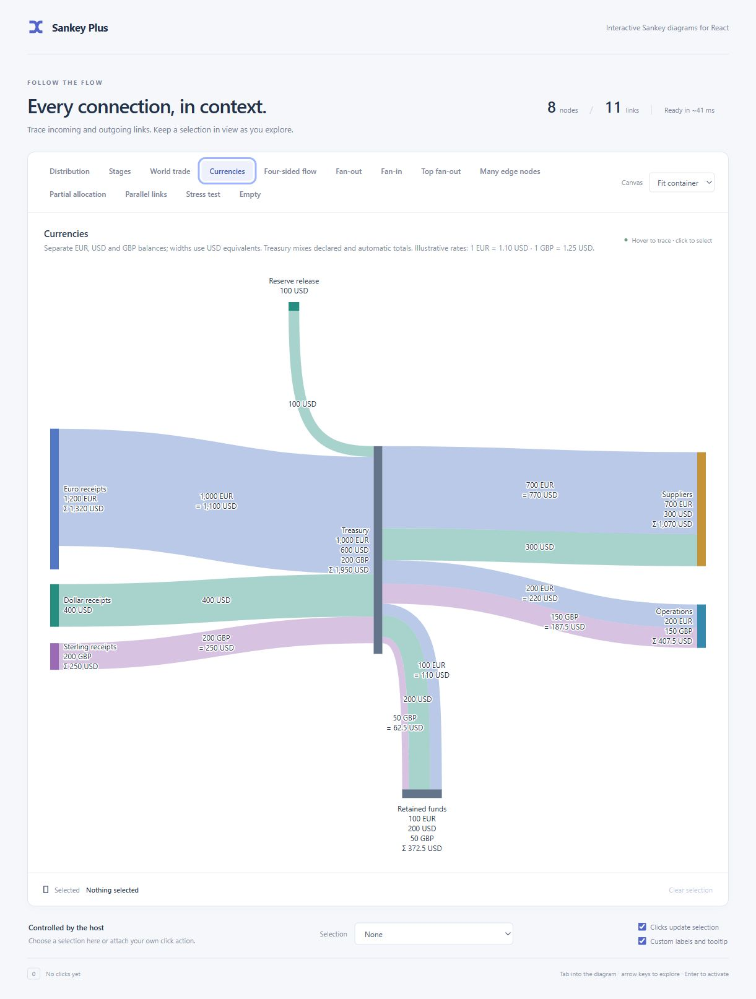
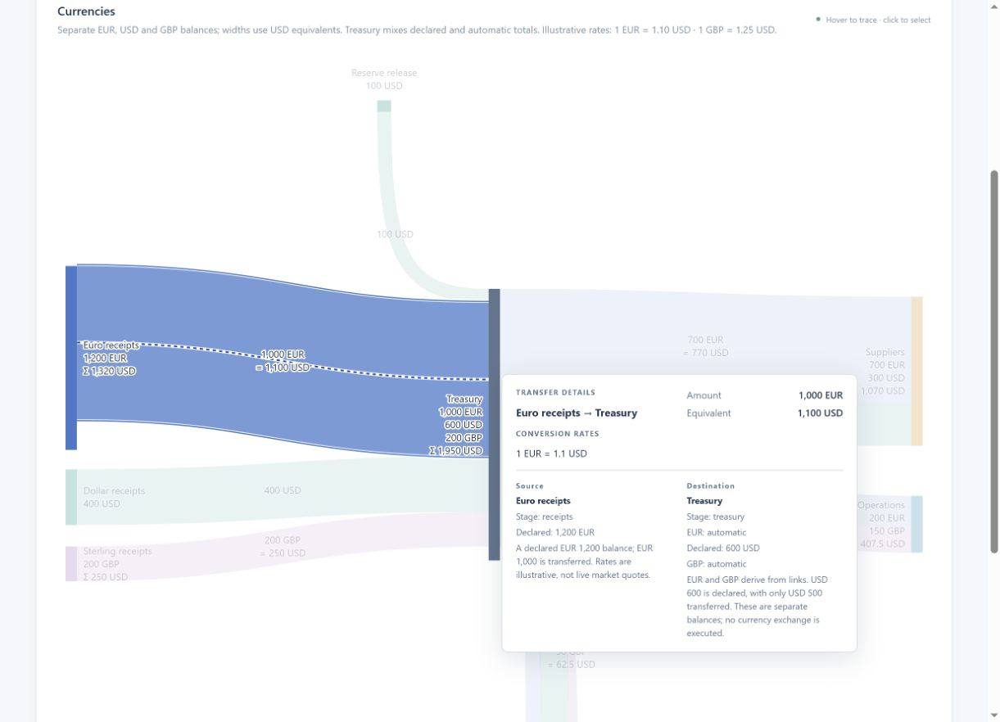
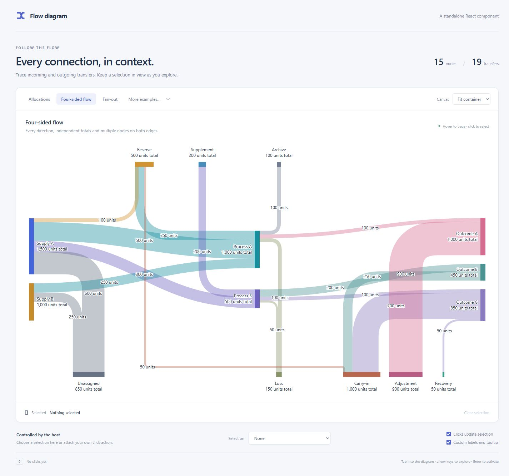

# Example catalog

[Back to README](../README.md)

[Open the live demo](https://bwin.github.io/sankey-plus/) or [run it locally](development.md). Every example is a normal tab; Left/Right arrows change tabs and Home/End reach the first/last. Use the Canvas selector to try narrow layouts, the external selection control to select independently of clicks, and the custom-label toggle to compare presentation.

| Example | What to inspect |
| --- | --- |
| Distribution | Medium-complexity flow, partial totals, dark theme, and link tooltips with both endpoint nodes and metadata. |
| Stages | Explicit Collect → Prepare → Deliver columns, node-array order within each column, and a forward link that skips Prepare. |
| World trade | Exporting/importing countries, totals per good, top reserve releases and bottom inventory outflows. Illustrative USD billions with consistent commodity colors. |
| Currencies | Separate EUR/USD/GBP balances, declared and automatic totals, a combined USD valuation, rate equations, top reserve and bottom retained funds. |
| Four-sided flow | Multiple top/bottom nodes, both directions and a mixed-role edge relay. Recovery retains its slot when its source wraps. |
| Fan-out / Top fan-out | Separate ordered turns below and above the main sequence. |
| Fan-in | Three unequal inputs converging on one bottom node, with reversed arrival order and a derived total. |
| Many edge nodes | Twelve destinations wrapping into rows with separate lanes. |
| Partial allocation | A 1,000-unit node with a 500-unit transfer; no unused edge bands. |
| Parallel links | Three distinct ribbons between the same pair of nodes, each independently inspectable and selectable. |
| Stress test | The same 100-node/300-link graph as the command-line stress benchmark. Dense crossings are expected. |
| Empty | No data and no chart SVG. |

All examples share custom labels/tooltips, node/link activation, host-controlled selection and keyboard inspection. The stress demo's measured browser text and two-line labels can produce different geometry from the CPU benchmark. Its timing readout includes scheduling and frame waits; see [development](development.md).

## Explicit stages

The [Stages fixture](https://github.com/bwin/sankey-plus/blob/master/demo/stages.json) deliberately interleaves nodes from different stages in its node array. The stage array still fixes the three columns:

```ts
stages: ['collect', 'prepare', 'deliver']
```

Within Prepare, `prepare-b` appears before `prepare-a`, so B stays above A. The gold 100-unit `bypass` link goes directly from Collect A to Deliver A without shifting either stage. Stage keys identify columns; they do not create built-in headings. Same-stage and backward links are invalid. See [stages and order](api.md#stages-and-order).


## World trade

The [World trade fixture](../demo/trade.json) has 18 nodes and 26 links across `exporters`, `global-goods` and `importers`, plus two top and two bottom nodes. It uses **invented annual values in USD billions**, not actual trade statistics. The four center nodes aggregate the goods available from current exports and opening warehouse stocks:

| Good | Current exports | Opening stocks released (top) | Total available | Current imports | Held for next year (bottom) |
| --- | ---: | ---: | ---: | ---: | ---: |
| Grain | $100 bn | $20 bn | $120 bn | $120 bn | — |
| Energy | $160 bn | $30 bn | $190 bn | $190 bn | — |
| Machinery | $240 bn | — | $240 bn | $215 bn | $25 bn |
| Electronics | $300 bn | — | $300 bn | $285 bn | $15 bn |

The top nodes release previously exported grain and energy from storage; these are not new exports by the countries on the left. The bottom nodes hold some current machinery and electronics exports in trade warehouses for delivery next year; these are excluded from current imports on the right. This is a simplified stock-flow example at a common value basis, not an accounting model for official trade statistics.

Exports ($800 bn) plus reserves released ($50 bn) equal imports ($810 bn) plus inventory held ($40 bn). Each good still balances when stock movements are included, so its derived total counts its available value once. Commodity colors continue through all connections; labels distinguish exports, imports, available goods, released reserves and stored inventory. A country appearing on both sides has distinct node keys; the external-selection menu also includes its stage to distinguish those entries.

Inspect Energy to emphasize its exporters, reserve source, importers and seven incident links. Inspect a reserve or inventory link to read why it enters or leaves the annual flow in the endpoint descriptions. These are aggregate flows: the example does not claim which exporter supplies a particular importer. Turning custom labels off retains currency formatting while using the component's default presentation.



## Currencies

The [Currencies fixture](../demo/currencies.json) has 8 nodes and 11 links. It uses invented rates of **1 EUR = 1.10 USD** and **1 GBP = 1.25 USD**, supplied on the receipt links. The graph's default unit is USD; links without a unit inherit it. Rates value the flows without exchanging the currency at either endpoint.

Treasury declares `totals: { EUR: 'auto', USD: 600, GBP: 'auto' }`. It shows 1,000 EUR, 600 USD and 200 GBP separately, plus a combined total of 1,950 USD. Incoming and outgoing flows each total 1,850 USD, leaving 100 USD of declared capacity unallocated. Euro receipts also declares more than it transfers: 1,200 EUR versus 1,000 EUR. Suppliers, Operations and Retained funds derive all their balances from links.

Inspect a EUR or GBP link to see its native amount, USD equivalent, conversion rate and both endpoint descriptions. Inspect Treasury to see which balances are declared or derived. Turning custom presentation off still displays per-unit labels, combined totals and conversion equations using the library defaults. The top reserve releases USD; the bottom node retains three separate currency balances. [Unit semantics and the public interface](units.md).





## Fan-in

The [Fan-in fixture](https://github.com/bwin/sankey-plus/blob/master/demo/fan-in.json) sends 600, 250 and 150 units from three stage nodes to one bottom node. Combined derives its 1,000-unit total from these incoming links. The lowest source arrives at the leftmost slot on the horizontal destination bar; the upper sources arrive farther right, keeping the turns from crossing. This complements the existing fan-out examples.


## Parallel links

The [Parallel links fixture](https://github.com/bwin/sankey-plus/blob/master/demo/parallel-links.json) uses the same `from` and `to` for three links. Each has its own unique `key`, amount and color:

```ts
links: [
  { key: 'main', from: 'source', to: 'destination', amount: 300, color: '#168e9d' },
  { key: 'secondary', from: 'source', to: 'destination', amount: 150, color: '#c58a29' },
  { key: 'small', from: 'source', to: 'destination', amount: 50, color: '#8170b4' },
]
```

Inspect a node to emphasize all three links. Inspect a single ribbon to emphasize only it and its two endpoints. Click a ribbon or use the external selection control to select it; the demo includes each amount in the selection labels to distinguish these links. They are not aggregated into one transfer.


Examples live in [demo/fixtures.ts](https://github.com/bwin/sankey-plus/blob/master/demo/fixtures.ts), with JSON scene files beside it.


