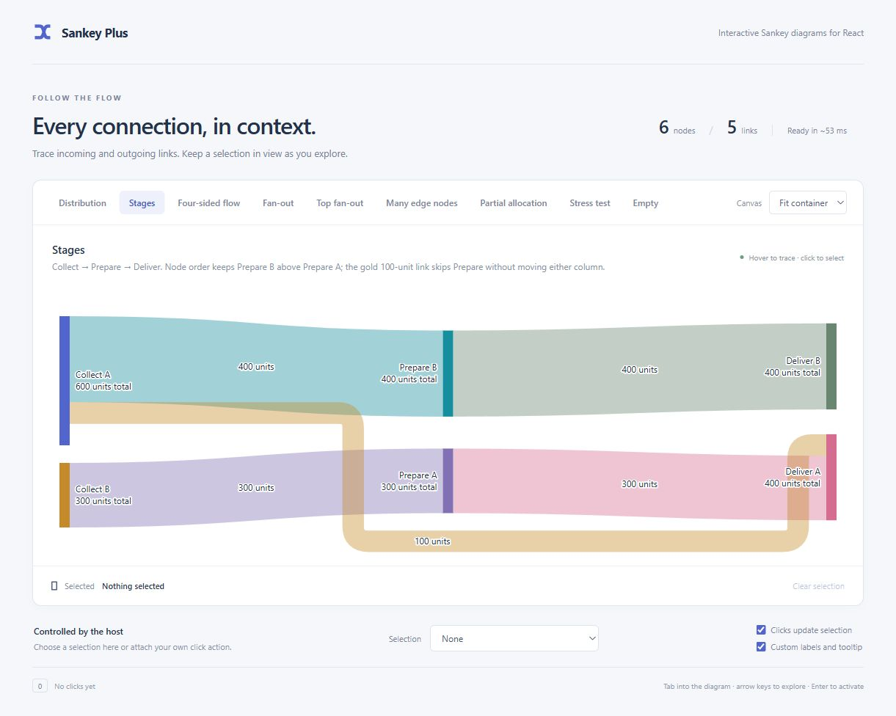
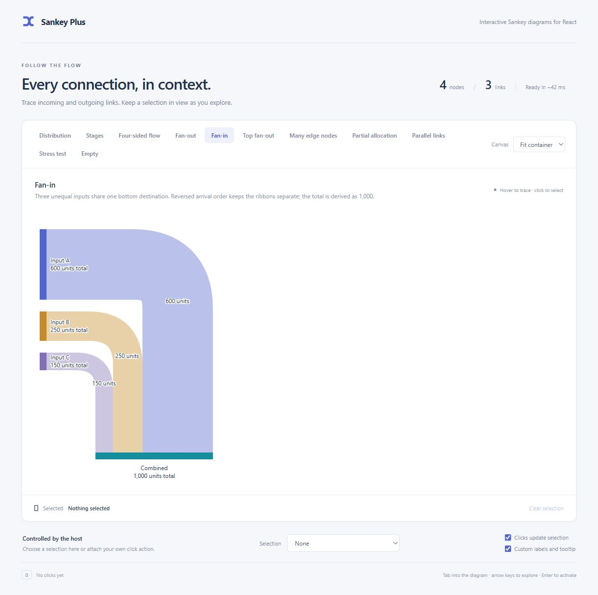
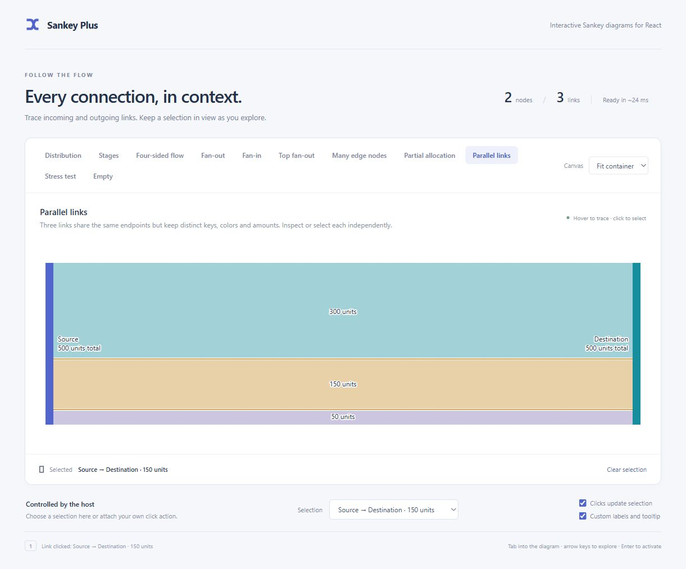

# Example catalog

[Back to README](../README.md)

[Open the live demo](https://bwin.github.io/sankey-plus/) or [run it locally](development.md). Every example is a normal tab; Left/Right arrows change tabs and Home/End reach the first/last. Use the Canvas selector to try narrow layouts, the external selection control to select independently of clicks, and the custom-label toggle to compare presentation.

| Example | What to inspect |
| --- | --- |
| Distribution | Medium-complexity flow, partial totals, dark theme, and link tooltips with both endpoint nodes and metadata. |
| Stages | Explicit Collect → Prepare → Deliver columns, node-array order within each column, and a forward link that skips Prepare. |
| Four-sided flow | Multiple top/bottom nodes, both directions and a mixed-role edge relay. Recovery retains its slot when its source wraps. |
| Fan-out / Top fan-out | Separate ordered turns below and above the main sequence. |
| Fan-in | Three unequal inputs converging on one bottom node, with reversed arrival order and a derived total. |
| Many edge nodes | Twelve destinations wrapping into rows with separate lanes. |
| Partial allocation | A 1,000-unit node with a 500-unit transfer; no unused edge bands. |
| Parallel links | Three distinct ribbons between the same pair of nodes, each independently inspectable and selectable. |
| Stress test | The same 100-node/300-link graph as the command-line stress benchmark. Dense crossings are expected. |
| Empty | No data and no chart SVG. |

All examples share custom labels/tooltips, node/link activation, host-controlled selection and keyboard inspection. The stress demo's measured browser text and two-line labels can produce different geometry from the CPU benchmark. Its timing readout includes scheduling and frame waits; see [development](development.md).

## Explicit stages

The [Stages fixture](https://github.com/bwin/sankey-plus/blob/master/demo/stages.json) deliberately interleaves nodes from different stages in its node array. The stage array still fixes the three columns:

```ts
stages: ['collect', 'prepare', 'deliver']
```

Within Prepare, `prepare-b` appears before `prepare-a`, so B stays above A. The gold 100-unit `bypass` link goes directly from Collect A to Deliver A without shifting either stage. Stage keys identify columns; they do not create built-in headings. Same-stage and backward links are invalid. See [stages and order](api.md#stages-and-order).



## Fan-in

The [Fan-in fixture](https://github.com/bwin/sankey-plus/blob/master/demo/fan-in.json) sends 600, 250 and 150 units from three stage nodes to one bottom node. Combined derives its 1,000-unit total from these incoming links. The lowest source arrives at the leftmost slot on the horizontal destination bar; the upper sources arrive farther right, keeping the turns from crossing. This complements the existing fan-out examples.



## Parallel links

The [Parallel links fixture](https://github.com/bwin/sankey-plus/blob/master/demo/parallel-links.json) uses the same `from` and `to` for three links. Each has its own unique `key`, amount and color:

```ts
links: [
  { key: 'main', from: 'source', to: 'destination', amount: 300, color: '#168e9d' },
  { key: 'secondary', from: 'source', to: 'destination', amount: 150, color: '#c58a29' },
  { key: 'small', from: 'source', to: 'destination', amount: 50, color: '#8170b4' },
]
```

Inspect a node to emphasize all three links. Inspect a single ribbon to emphasize only it and its two endpoints. Click a ribbon or use the external selection control to select it; the demo includes each amount in the selection labels to distinguish these links. They are not aggregated into one transfer.



Examples live in [demo/fixtures.ts](https://github.com/bwin/sankey-plus/blob/master/demo/fixtures.ts), with JSON scene files beside it.


