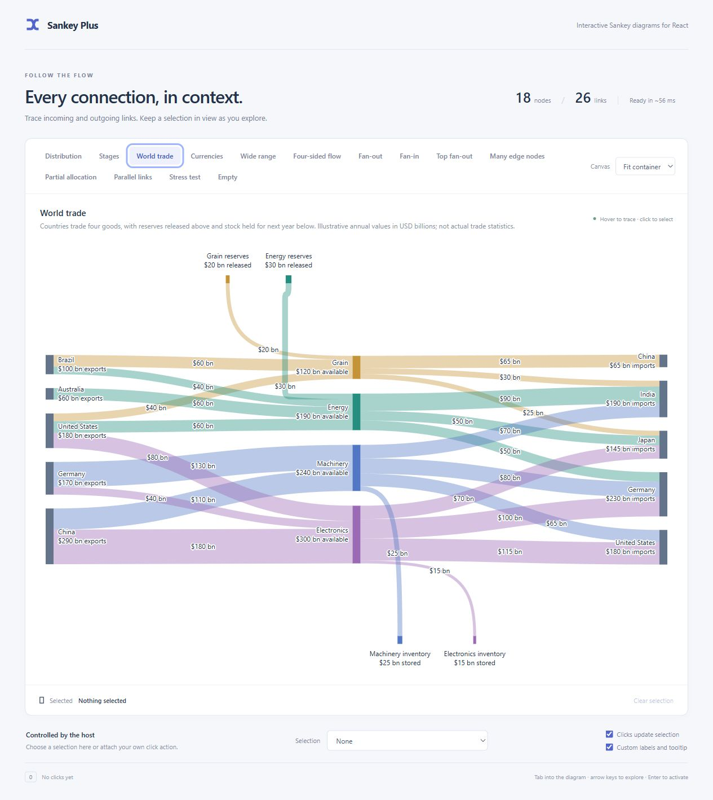
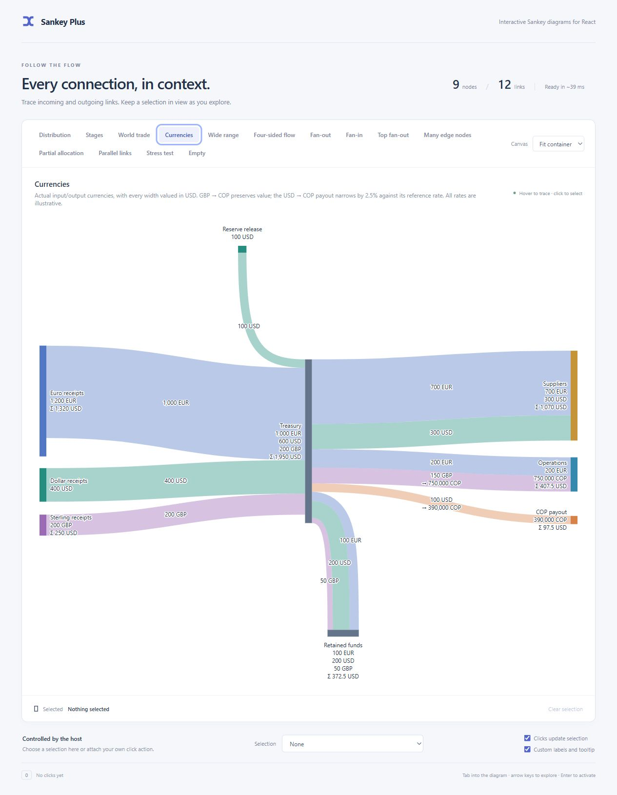
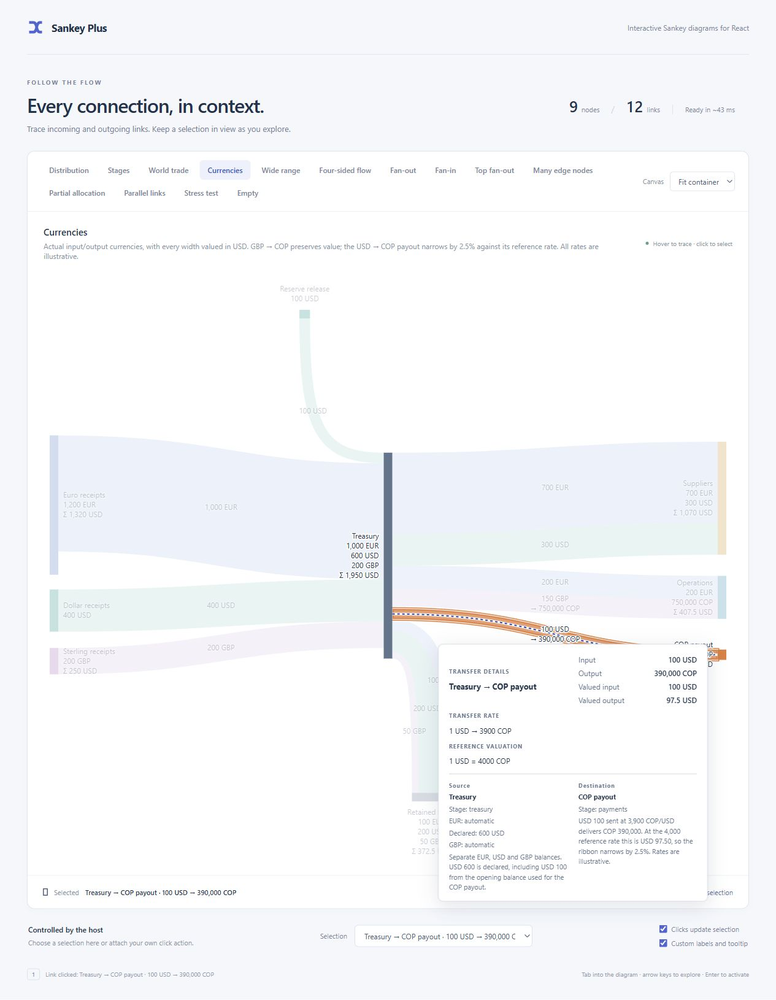
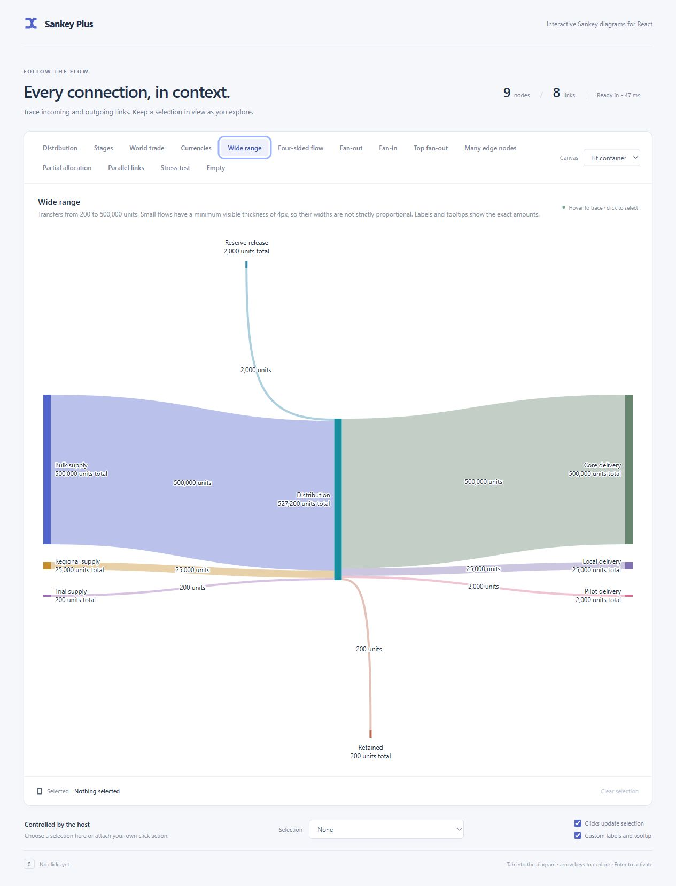
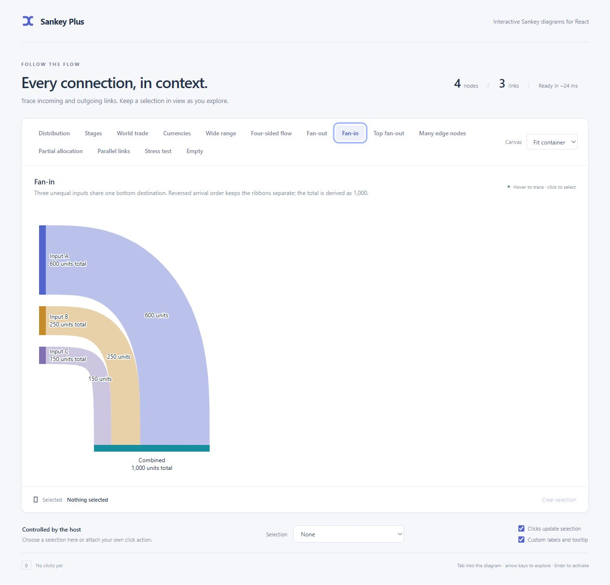
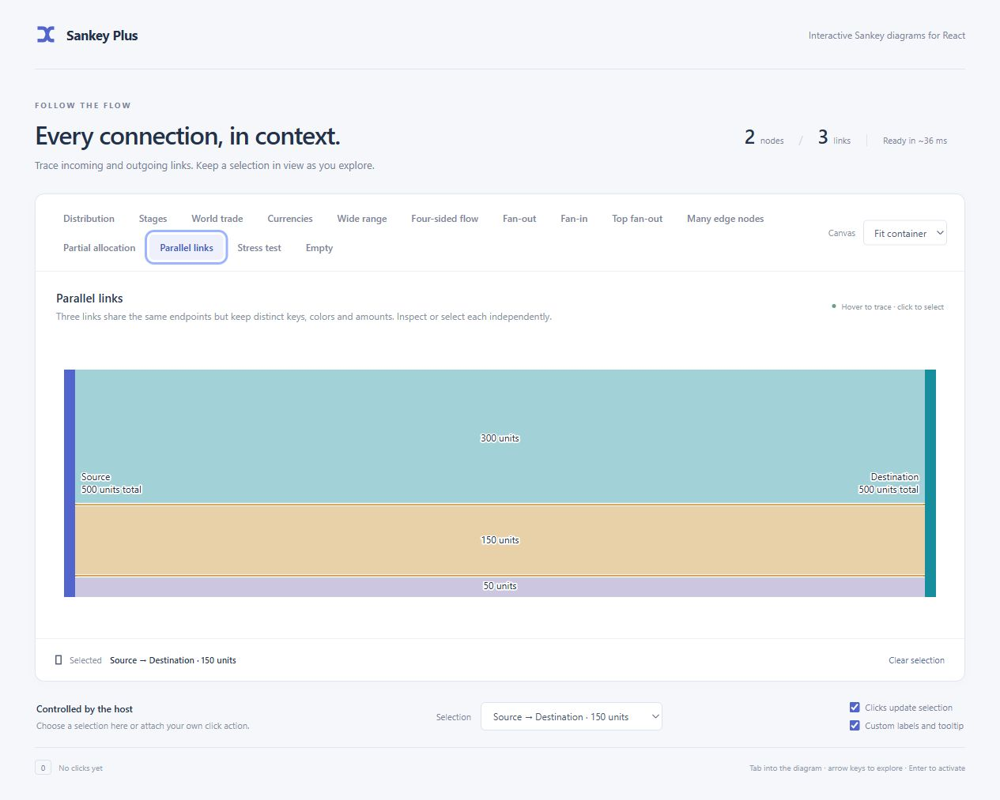
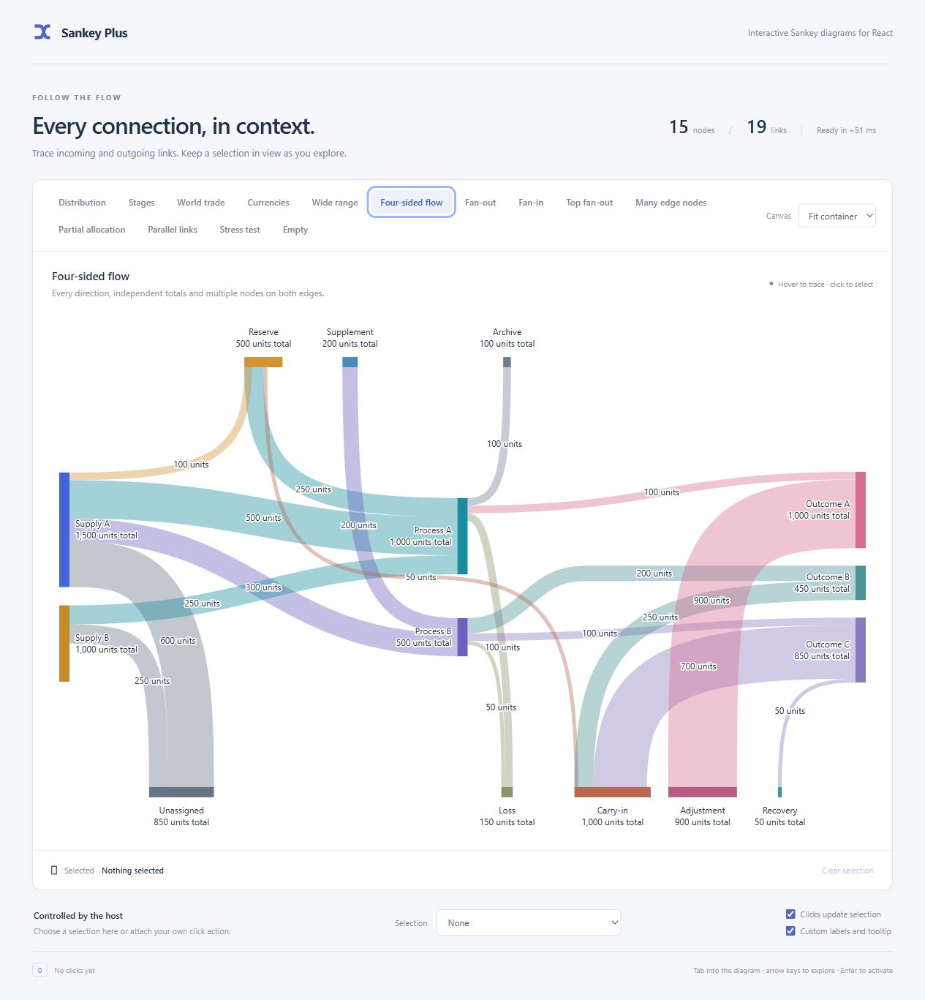

# Example catalog

[Back to README](../README.md)

[Open the live demo](https://bwin.github.io/sankey-plus/) or [run it locally](development.md). Every example is a normal tab; Left/Right arrows change tabs and Home/End reach the first/last. Use the Canvas selector to try narrow layouts, the external selection control to select independently of clicks, and the custom-label toggle to compare presentation.

| Example               | What to inspect                                                                                                                                                  |
| --------------------- | ---------------------------------------------------------------------------------------------------------------------------------------------------------------- |
| Distribution          | Medium-complexity flow, partial totals, dark theme, and link tooltips with both endpoint nodes and metadata.                                                     |
| Inspection bridge     | External `highlight` on the Distribution graph, with a live `onInspectChange` subject/modality readout and independent selection.                                |
| Linked table          | A focusable node/link table that drives chart emphasis and mirrors chart inspection back into the active row, without changing selection.                        |
| Stages                | Explicit Collect → Prepare → Deliver columns, node-array order within each column, and a forward link that skips Prepare.                                        |
| World trade           | Exporting/importing countries, totals per good, top reserve releases and bottom inventory outflows. Illustrative USD billions with consistent commodity colors.  |
| Currencies            | Separate currency balances, explicit input/output currencies, USD-valued widths, equal-value conversion and a 2.5% taper, top reserve and bottom retained funds. |
| Wide range            | 200–500,000-unit transfers with a 4px minimum visible thickness; exact amounts stay in labels and tooltips.                                                      |
| Four-sided flow       | Multiple top/bottom nodes, both directions and a mixed-role edge relay. Recovery retains its slot when its source wraps.                                         |
| Fan-out / Top fan-out | Separate ordered turns below and above the main sequence.                                                                                                        |
| Fan-in                | Three unequal inputs converging on one bottom node, with reversed arrival order and a derived total.                                                             |
| Many edge nodes       | Twelve destinations wrapping into rows with separate lanes.                                                                                                      |
| Partial allocation    | A 1,000-unit node with a 500-unit transfer; no unused edge bands.                                                                                                |
| Parallel links        | Three distinct ribbons between the same pair of nodes, each independently inspectable and selectable.                                                            |
| Stress test           | The same 100-node/300-link graph as the command-line stress benchmark. Dense crossings are expected.                                                             |
| Empty                 | No data and no chart SVG.                                                                                                                                        |

All examples share custom labels/tooltips, node/link activation, host-controlled selection and keyboard inspection. The stress demo's measured browser text and two-line labels can produce different geometry from the CPU benchmark. Its timing readout includes scheduling and frame waits; see [development](development.md).

## Inspection bridge

The Inspection bridge tab reuses the Distribution graph. Its host panel passes a chosen node as `highlight`, so that node, its incident links and their endpoints are emphasized without a pointer. Hover, focus or tap the diagram to see `onInspectChange` report the subject key and `pointer`, `keyboard` or `touch`; dismissal reports `none`. Pointer hover updates the readout visually without queuing a live announcement; keyboard, touch and dismissal are announced politely. When an internal inspection and the external highlight are both active, their one-hop sets are unioned. The selection control remains independent and can select a link while a different node stays externally emphasized.

## Linked table

The Linked table tab also reuses the Distribution graph, but renders every node and link as a keyboard-focusable row below the chart. The two views are linked in both directions, and neither direction changes the controlled selection.

- **Table to chart.** Entering or focusing a node row sets `highlight` to that node. Entering or focusing a link row sets the link. The chart emphasizes the subject and its one-hop neighborhood exactly as it does for internal inspection. Leaving the row or moving focus away clears the external highlight.
- **Chart to table.** Hovering, focusing or tapping a chart node or link fires `onInspectChange`. The matching table row becomes current, so a reader can move between the picture and the itemized flow without losing context.
- External `highlight` is emphasis only and does not fire `onInspectChange`. The table therefore keeps its own `hovered` state, while the chart's reported inspection remains separate. If both are active, the chart unions their one-hop sets.
- **Selection stays independent.** Table hover does not select anything. Use chart clicks or the external selection control; the selected subject keeps its own outline even while rows and chart emphasis move.

The demo keeps one active-row style and exposes `data-table-active` plus `data-chart-active` when an integration needs to distinguish which surface started the emphasis. The table has a scrollable body and sticky header; every row is focusable, while the chart retains its single roving tab stop.

```tsx
const [highlight, setHighlight] = useState<SankeySubject | null>(null);
const [inspection, setInspection] = useState<SankeyInspection | null>(null);

<SankeyDiagram
  graph={graph}
  highlight={highlight}
  onInspectChange={setInspection}
  selection={selection}
  onNodeClick={(facts) => setSelection({ kind: 'node', key: facts.node.key })}
/>;

<tr
  tabIndex={0}
  data-chart-active={
    inspection?.subject.kind === 'node' && inspection.subject.key === node.key
      ? 'true'
      : 'false'
  }
  onMouseEnter={() => setHighlight({ kind: 'node', key: node.key })}
  onMouseLeave={() => setHighlight(null)}
  onFocus={() => setHighlight({ kind: 'node', key: node.key })}
  onBlur={() => setHighlight(null)}
>
  {/* subject, placement and value cells */}
</tr>;
```

Link rows use the same wiring with `{ kind: 'link', key: link.key }`. Attach `onInspectChange` when the host needs the chart-to-table direction; attaching it while a subject is already inspected replays that subject once.

## Explicit stages

The [Stages fixture](https://github.com/bwin/sankey-plus/blob/master/demo/stages.json) deliberately interleaves nodes from different stages in its node array. The stage array still fixes the three columns:

```ts
stages: ['collect', 'prepare', 'deliver'];
```

Within Prepare, `prepare-b` appears before `prepare-a`, so B stays above A. The gold 100-unit `bypass` link goes directly from Collect A to Deliver A without shifting either stage. Stage keys identify columns; they do not create built-in headings. Same-stage and backward links are invalid. See [stages and order](api.md#stages-and-order).


## World trade

The [World trade fixture](../demo/trade.json) has 18 nodes and 26 links across `exporters`, `global-goods` and `importers`, plus two top and two bottom nodes. It uses **invented annual values in USD billions**, not actual trade statistics. The four center nodes aggregate the goods available from current exports and opening warehouse stocks:

| Good        | Current exports | Opening stocks released (top) | Total available | Current imports | Held for next year (bottom) |
| ----------- | --------------: | ----------------------------: | --------------: | --------------: | --------------------------: |
| Grain       |         $100 bn |                        $20 bn |         $120 bn |         $120 bn |                           — |
| Energy      |         $160 bn |                        $30 bn |         $190 bn |         $190 bn |                           — |
| Machinery   |         $240 bn |                             — |         $240 bn |         $215 bn |                      $25 bn |
| Electronics |         $300 bn |                             — |         $300 bn |         $285 bn |                      $15 bn |

The top nodes release previously exported grain and energy from storage; these are not new exports by the countries on the left. The bottom nodes hold some current machinery and electronics exports in trade warehouses for delivery next year; these are excluded from current imports on the right. This is a simplified stock-flow example at a common value basis, not an accounting model for official trade statistics.

Exports ($800 bn) plus reserves released ($50 bn) equal imports ($810 bn) plus inventory held ($40 bn). Each good still balances when stock movements are included, so its derived total counts its available value once. Commodity colors continue through all connections; labels distinguish exports, imports, available goods, released reserves and stored inventory. A country appearing on both sides has distinct node keys; the external-selection menu also includes its stage to distinguish those entries.

Inspect Energy to emphasize its exporters, reserve source, importers and seven incident links. Inspect a reserve or inventory link to read why it enters or leaves the annual flow in the endpoint descriptions. These are aggregate flows: the example does not claim which exporter supplies a particular importer. Turning custom labels off retains currency formatting while using the component's default presentation.



## Currencies

The [Currencies fixture](../demo/currencies.json) has 9 nodes and 12 links. All amounts and rates are illustrative. The graph's default unit is USD, with reference rates of **1 EUR = 1.10 USD**, **1 GBP = 1.25 USD** and **1 USD = 4,000 COP**. Each link explicitly names its input and output currency. Reference rates determine all widths; each transfer's own rate determines the amount delivered.

Treasury declares `totals: { EUR: 'auto', USD: 600, GBP: 'auto' }`. It shows 1,000 EUR, 600 USD and 200 GBP separately, plus a combined total of 1,950 USD. Incoming value is 1,850 USD and outgoing value is 1,950 USD: its declared USD balance includes 100 USD of opening funds for the COP payout. Euro receipts declares more than it transfers: 1,200 EUR versus 1,000 EUR. Destination nodes derive their balances from the amounts actually received.

Two links demonstrate currency conversion:

- Treasury sends **150 GBP → 750,000 COP** to Operations at 5,000 COP/GBP. Both ends are worth 187.50 USD at the reference rates, so the ribbon stays the same width. Operations receives 200 EUR on another link, giving it two separate balances and a combined total of 407.50 USD.
- Treasury sends **100 USD → 390,000 COP** to COP payout at 3,900 COP/USD. The destination receives a value of 97.50 USD at the reference rate of 4,000, so this ribbon narrows by 2.5%. The large numerical FX ratio does not produce a wider ribbon.

Inspect either conversion link to see its actual input/output amounts and transfer rate, followed by USD valuations and the graph's reference rates. Source and destination details stay in two columns below. Inspect Treasury to see declared and derived balances. Turning custom presentation off retains these distinctions in the library defaults. The top reserve releases USD; Retained funds at the bottom holds separate EUR/USD/GBP balances. [Unit semantics and the public interface](units.md).





## Wide range

The [Wide range fixture](../demo/wide-range.json) has 9 nodes and 8 links with amounts of **200, 2,000, 25,000 and 500,000 units**. Three sources and a top reserve release feed Distribution, which passes 527,200 units to three destinations and a bottom retained balance.

This example sets **`minLinkWidth={4}`**. Large ribbons follow the value scale; the 200-unit and 2,000-unit transfers are both raised to 4 CSS pixels. Their widths are therefore not strictly proportional, as the description explains. Labels, tooltips, callbacks and totals retain exact amounts. Node bars and routing reserve the displayed widths. Try the Trial supply link and the bottom Retained link.

The library defaults to `minLinkWidth={0}`, retaining the original [proportional rendering](../screenshots/docs-wide-range-proportional.jpg). [Minimum-width semantics](api.md#quantities).



## Fan-in

The [Fan-in fixture](https://github.com/bwin/sankey-plus/blob/master/demo/fan-in.json) sends 600, 250 and 150 units from three stage nodes to one bottom node. Combined derives its 1,000-unit total from these incoming links. The lowest source arrives at the leftmost slot on the horizontal destination bar; the upper sources arrive farther right, keeping the turns from crossing. This complements the existing fan-out examples.



## Parallel links

The [Parallel links fixture](https://github.com/bwin/sankey-plus/blob/master/demo/parallel-links.json) uses the same `from` and `to` for three links. Each has its own unique `key`, amount and color:

```ts
links: [
  {
    key: 'main',
    from: 'source',
    to: 'destination',
    amount: 300,
    color: '#168e9d',
  },
  {
    key: 'secondary',
    from: 'source',
    to: 'destination',
    amount: 150,
    color: '#c58a29',
  },
  {
    key: 'small',
    from: 'source',
    to: 'destination',
    amount: 50,
    color: '#8170b4',
  },
];
```

Inspect a node to emphasize all three links. Inspect a single ribbon to emphasize only it and its two endpoints. Click a ribbon or use the external selection control to select it; the demo includes each amount in the selection labels to distinguish these links. They are not aggregated into one transfer.



Examples live in [demo/fixtures.ts](https://github.com/bwin/sankey-plus/blob/master/demo/fixtures.ts), with JSON scene files beside it.


