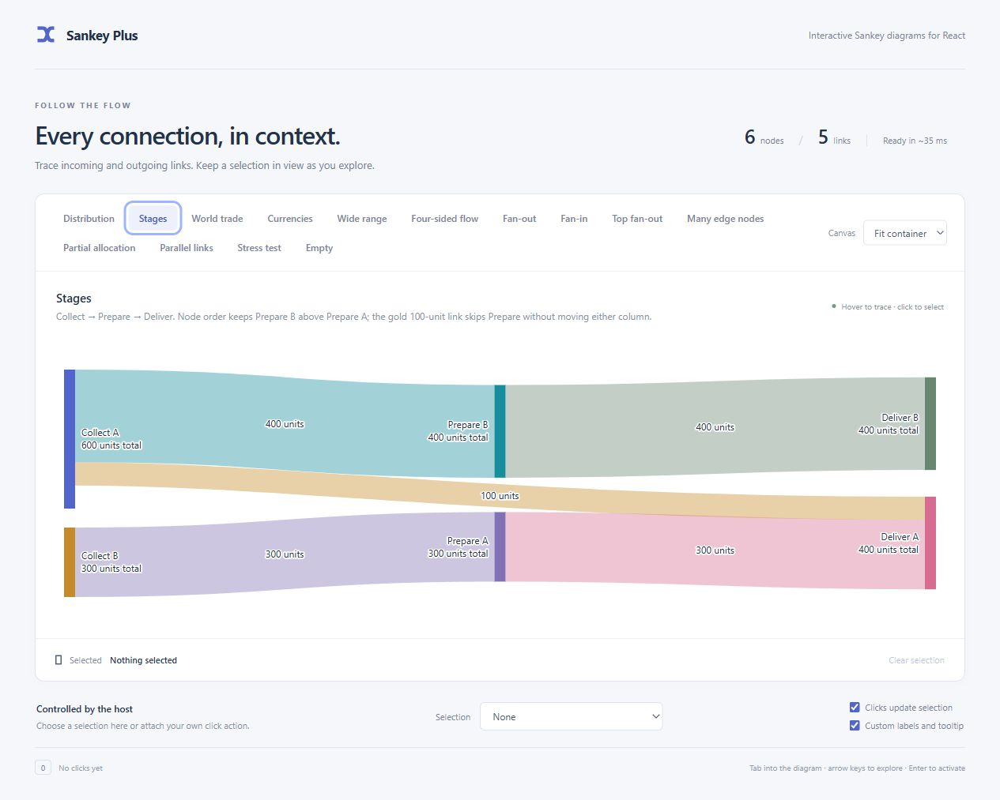
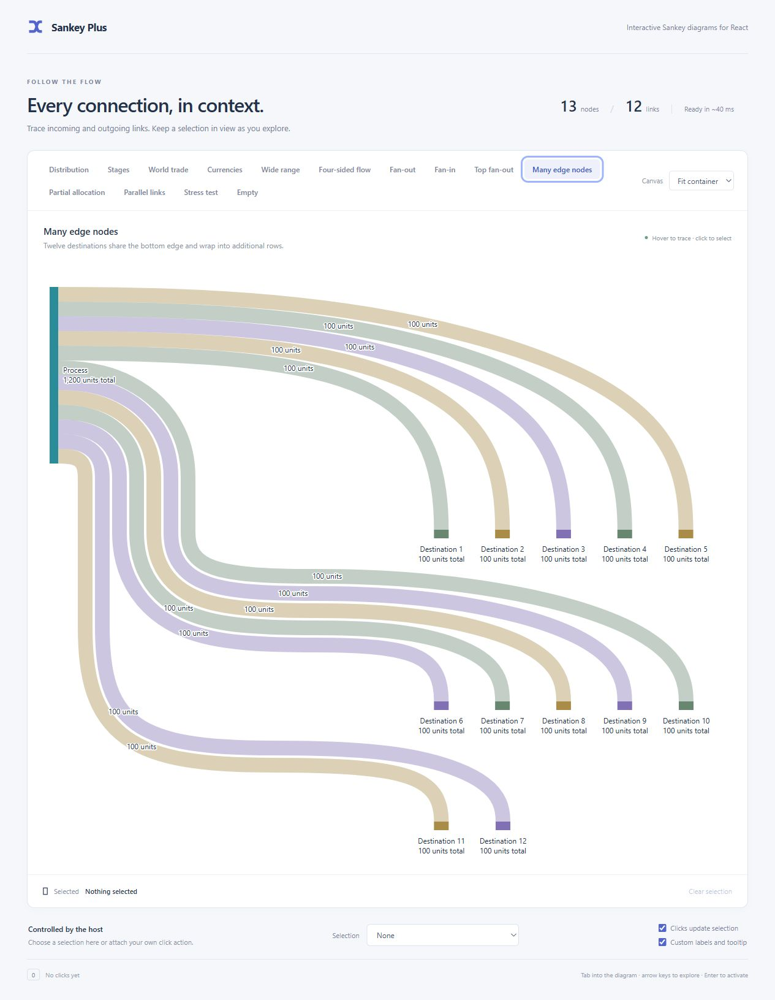

# Layout and interaction

[Back to README](../README.md)

## Interaction and selection

- Inspecting a node keeps that node, all directly incoming/outgoing links, and every node those links touch strong. Everything else fades. This is one hop, not recursive traversal or all links between highlighted neighbors.
- Inspecting a link keeps only that link and its two endpoint nodes strong.
- Node, link and label opacity eases between inspection states in 120 ms. Tooltips, selection outlines and keyboard focus update immediately. The fade is disabled when the system requests reduced motion.
- Visible node and link labels activate their own subject. Node labels take priority over ribbons passing behind them; hidden labels do not create invisible click targets.
- Pointer movement inspects; leaving clears pointer inspection. Touch taps activate and pin details; dragging cancels activation. Tapping outside dismisses details.
- One roving tab stop enters the diagram. Arrow keys move through nodes then links in input order; Home/End jump to the ends. Enter/Space activate once. Escape dismisses inspection. Tab leaves normally.
- Keyboard focus works after pointer use, including clicks on empty chart space. Keyboard/touch details follow the inspected subject when resizing or scrolling changes its position.
- Activation calls the relevant handler. It never changes selection internally. The host may select, navigate, open a panel, or ignore the click.
- Selection uses a persistent solid outline in the selected node/link's own color, separated from its fill and surroundings by the surface color. The outline remains fully opaque when its fill fades during unrelated inspection. Keyboard focus uses a dashed indicator. Escape does not change selection. A selected key removed from the graph is ignored without a callback.

## Scene transitions

`transition` optionally crossfades one completed scene into the next completed scene after graph or layout changes. The old drawing fades out while the new drawing fades in. Nodes, links and labels are not moved or tweened, and no intermediate layout is calculated. The old copy is clipped to the current scene and ignores pointer input, is hidden from assistive technology and has no tab stops; focus, hit testing and tooltips belong to the new scene only.

`duration` defaults to 280 ms and `easing` to `ease-out`. `duration: 0` disables the effect, and `prefers-reduced-motion: reduce` skips it entirely. Rapid updates replace the previous fading copy instead of stacking overlays. The snapshot is refreshed when selection changes, so the fading copy reflects the selected subject; transient hover/emphasis is not captured. Options that alter scene markup follow the same refresh rule. Container resize and font measurement can also trigger a new completed scene and therefore a transition. The inspection fade is separate and still runs in 120 ms. See [the Transitions example](examples.md#transitions).

## Layout and routing

Top/bottom nodes are horizontal quantitative bars with full labels, facts and interactions. Both link directions use the inward face: below a top bar and above a bottom bar. Multiple edge nodes pack within their valid source/target intervals and wrap into rows. A side without nodes reserves no extra band.

All links use smooth cubic curves. Main-stage connections ease between horizontal ports; edge connections bend gradually between horizontal and vertical ports. Before taking an obstacle detour, the router tries earlier/later direct bends. This lets skipping-stage links use existing gaps and keeps edge links broad when a different approach clears a sibling's label. Edge alternatives also check ribbon overlap so fixing a label collision does not squeeze a previously separated fan together. Obstacle detours join several curves with matching tangent directions; tight passages can still require shorter bends and straight sections. Ribbon widths encode amounts using the same scale as the node bars.

Crossing, ribbon-overlap and obstacle checks use adaptively sampled points from these same curves, with a 0.1-pixel flattening tolerance. Hit testing and label placement also use those samples. The search therefore evaluates the rendered bend, rather than just its control polygon or an earlier orthogonal route.

When a transfer's endpoints have different reference values, its width eases between their default-unit amounts along the curve. Ports use each endpoint's own width; the painted envelope, pointer hit testing and selection outline follow the taper. Constant-value transfers retain the original stroked-curve rendering. Obstacle routing conservatively reserves the wider endpoint's clearance for a tapered ribbon, which can leave extra room near its thinner end.

`minLinkWidth` optionally gives each ribbon endpoint a minimum displayed thickness. It participates in layout: ports stack at their displayed widths, each node bar fits the larger incoming/outgoing stack or its proportional total, and fan lanes, overlap checks and obstacle clearance use displayed dimensions. The common value scale can shrink to make room for these floors. If the floors alone exceed the available space, the central region grows vertically or the edge corridor grows horizontally; they are never silently compressed. Labels and facts retain the true values. This is an explicit exception to strictly proportional widths, disabled by default.

Simple fan-out and fan-in use ordered ports. Bottom arrivals reverse vertical source order: a lower main source enters a shared bottom bar to the left of an upper source. Wrapped simple fan-out reserves separate vertical corridors and horizontal lanes. Row spacing grows with the combined ribbon widths, lane gaps and full label heights, including unequal amounts and multi-line balance labels. Destinations farther right turn closer to the preceding row; destinations farther left turn closer to their own row. This keeps their horizontal runs and connecting bends separate.

Inputs from edge nodes use their source bars' horizontal positions to order their destination slots. A detour needed for a wrapped row does not change that order: a rightmost bottom source still enters below its left-hand neighbor, with the mirrored rule for top sources.

Parallel links between the same main and edge nodes also have separate ports. Bottom arrivals and top departures reverse the edge-side input-order tie so turning between horizontal and vertical ports does not force a crossing. If a nearby label blocks the shared bend, the router tries adjusting the whole bundle before routing individual ribbons around obstacles.

Parallel stage links with matching port spacing also share a curve when independent waves would overlap on their sloping section. Their centerlines are offset perpendicular to the bend, keeping quantitative widths intact. This repair preserves ports and existing obstacle detours; it is accepted only when the bundle stays separate without new crossings, obstacle collisions or increased overlap with neighboring routes beyond sampling tolerance.

Simple fans use offsets from a shared curved centerline so adjacent ribbons bend together. Offsets scale independently along the two port axes: wide destination spacing spreads over the bend instead of compressing its last part into a hook. Wrapped fans reserve a 4 CSS-pixel gap in their vertical corridors and extra vertical room for the final approach to each row. The curves ease between touching source ports, separated corridors and spaced destinations without changing ribbon widths or inflating the node's total. Where both offsets are equal, the gap stays constant through the bend. Where the group fans out, gaps change gradually. The group switches to these shared curves together when space and obstacle clearance allow it; constrained layouts use individually routed smooth curves.

When a main-stage link and a top/bottom link enter the same node, the main-stage curve can reach its final entry height earlier and finish horizontally. This prevents a late curve from crossing the edge input and then crossing back again. The finish point accounts for the edge input's actual curved approach and ribbon width, including detours, rather than assuming it follows its source's vertical axis. The existing top/main/bottom port order stays intact. A bounded pass accepts the alternative only when sampled ribbon overlap decreases, no new crossing pair appears, and obstacle clearance does not worsen. It also checks for newly overlapping ribbon pairs, with a small tolerance for sampling noise and shared endpoints.

Complex graphs also use obstacle-aware paths and a bounded adjacent-port optimization. **Arbitrary graphs are not guaranteed to be crossing-free.** Main-stage order stays fixed. The implementation does not exhaustively reorder edge nodes or search every global layout. Dense, mixed or skipping-stage graphs can still contain crossings and overlapping ribbons. The supplied fixtures are checked for unrelated bar/label clearance.

Wrapping increases height. If stage spacing or an individual ribbon cannot clear obstacles at the available width, a wider internal canvas with a local horizontal scrollbar may be needed. Aggregate edge-node count alone does not force widening. Every resize starts from the current container width; expanding can remove rows and shrinking does not retain an old desktop minimum.

The chart creates a scroll container only when its canvas is wider than the host. Wheel input uses native browser scrolling and can continue to the surrounding page. Visual clipping uses `overflow: clip` without creating extra hidden scroll containers; no wheel handlers cancel or redirect input. Touch gestures also remain native: the canvas keeps `pan-x pan-y pinch-zoom` in `touch-action`, so pinch zoom is not cancelled by pointer inspection. A tap inspects and pins its subject.

The routing search is bounded. Pathological custom graphs may still need a larger host container. There is no promise of a globally optimal layout or perfect clearance for every possible graph.

## Snapshots and overlays

The completed scene is available as a typed read-only layout snapshot through `onLayout` and `getLayout()`; treat its maps and objects as immutable even though the maps are runtime `Map` instances. It contains the same measured geometry that was rendered: canvas extents, the top/bottom edge bands, the common value scale, central plot band, stage columns, node bars and layout-unit facts, painted link paths and widths, measured label boxes, and the final crossing/obstacle diagnostics. Labels retain the lines that were fitted to their available width; `labelHidden` marks a link label that was omitted to avoid a collision. `onLayout` reports each completed scene once; attaching a callback while a completed scene is current reports that snapshot once, and changing callback identity alone does not replay it.

For example, a host can read `plot.top` or `topBand` to place stage headings, use `nodes` rects to outline a subject, or read `diagnostics.crossings` to show whether a dense graph retains crossings. Snapshot coordinates are in the SVG view box, not screen coordinates. A resize keeps the previous complete snapshot and rendered scene current until the replacement completes. Changing the graph or layout options clears the snapshot to `null` until the new scene commits, so cached handles do not mix another graph's geometry with the current facts. See [snapshot fields](api.md#snapshot-fields).

`renderOverlay` adds decorative SVG after links, nodes and labels. The component wraps it in a `pointer-events: none`, `aria-hidden` group so annotations cannot capture pointer or keyboard input or duplicate accessible content. Use theme variables such as `--flow-muted-text` and `--flow-focus` to keep annotations legible on light and dark hosts. Overlays are for headings, callouts and other non-interactive context only. They must not be the sole source of important information, and they do not change layout, routing, hit testing or selection.

The [Layout overlay example](examples.md#layout-overlay) annotates the Distribution graph with stage headings and a callout around Process A, shows the snapshot's collision diagnostics, and downloads a self-contained SVG copy.

## Visual examples

The same curve style connects stages, top sources and bottom destinations:

Skipping-stage links can bend through the existing gap without a trip below the middle column:

Wrapped destinations use separate lanes and gradual arrivals, with additional height reserved when necessary:

See [performance](performance.md) for cooperative scheduling and [verification](verification.md) for tested cases and remaining limits.
