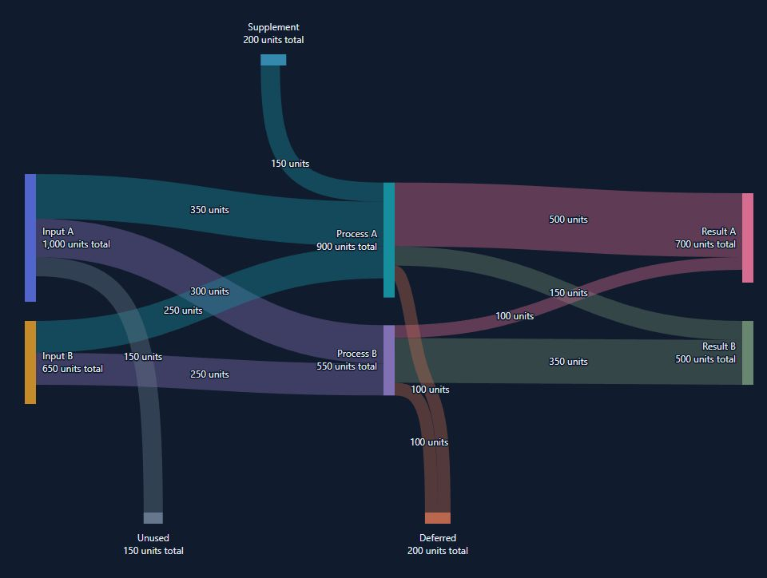
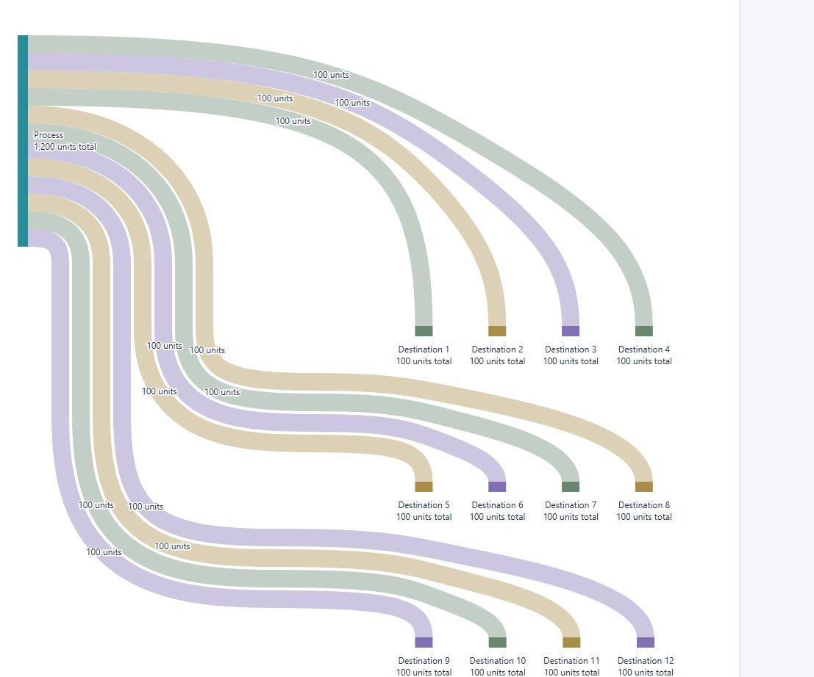

# Layout and interaction

[Back to README](../README.md)

## Interaction and selection

- Inspecting a node keeps that node, all directly incoming/outgoing links, and every node those links touch strong. Everything else fades. This is one hop, not recursive traversal or all links between highlighted neighbors.
- Inspecting a link keeps only that link and its two endpoint nodes strong.
- Visible node and link labels activate their own subject. Node labels take priority over ribbons passing behind them; hidden labels do not create invisible click targets.
- Pointer movement inspects; leaving clears pointer inspection. Touch taps activate and pin details; dragging cancels activation. Tapping outside dismisses details.
- One roving tab stop enters the diagram. Arrow keys move through nodes then links in input order; Home/End jump to the ends. Enter/Space activate once. Escape dismisses inspection. Tab leaves normally.
- Keyboard focus works after pointer use, including clicks on empty chart space. Keyboard/touch details follow the inspected subject when resizing or scrolling changes its position.
- Activation calls the relevant handler. It never changes selection internally. The host may select, navigate, open a panel, or ignore the click.
- Selection uses a persistent solid outline in the selected node/link's own color, separated from its fill and surroundings by the surface color. The outline remains fully opaque when its fill fades during unrelated inspection. Keyboard focus uses a dashed indicator. Escape does not change selection. A selected key removed from the graph is ignored without a callback.

## Layout and routing

Top/bottom nodes are horizontal quantitative bars with full labels, facts and interactions. Both link directions use the inward face: below a top bar and above a bottom bar. Multiple edge nodes pack within their valid source/target intervals and wrap into rows. A side without nodes reserves no extra band.

All links use smooth cubic curves. Main-stage connections ease between horizontal ports; edge connections bend gradually between horizontal and vertical ports. Obstacle detours join several curves with matching tangent directions. Tight passages may require shorter bends and straight sections, but do not switch to circular, rounded right-angle elbows. Ribbon widths still encode amounts using the same scale as the node bars.

Crossing, ribbon-overlap and obstacle checks use adaptively sampled points from these same curves, with a 0.1-pixel flattening tolerance. Hit testing and label placement also use those samples. The search therefore evaluates the rendered bend, rather than just its control polygon or an earlier orthogonal route.

Simple fan-out and fan-in use ordered ports. Bottom arrivals reverse vertical source order: a lower main source enters a shared bottom bar to the left of an upper source. Wrapped simple fan-out reserves separate vertical corridors and horizontal lanes. Row spacing grows with the combined ribbon widths and lane gaps, including unequal amounts and two-line labels. Destinations farther right turn closer to the preceding row; destinations farther left turn closer to their own row. This keeps their horizontal runs and connecting bends separate.

Inputs from edge nodes use their source bars' horizontal positions to order their destination slots. A detour needed for a wrapped row does not change that order: a rightmost bottom source still enters below its left-hand neighbor, with the mirrored rule for top sources.

Simple fans use offsets from a shared curved centerline so adjacent ribbons bend together. Wrapped fans reserve a 4 CSS-pixel gap in their vertical corridors; the curves ease between touching source ports, separated corridors and spaced destinations without changing ribbon widths or inflating the node's total. Where the offsets are constant, the gap stays constant through the bend. Where the group fans out, gaps change gradually. The group switches to these shared curves together when space and obstacle clearance allow it; constrained layouts use individually routed smooth curves.

When a main-stage link and a top/bottom link enter the same node, the main-stage curve can reach its final entry height earlier and finish horizontally. This prevents a late curve from crossing the edge input and then crossing back again. The finish point accounts for the edge input's actual curved approach and ribbon width, including detours, rather than assuming it follows its source's vertical axis. The existing top/main/bottom port order stays intact. A bounded pass accepts the alternative only when sampled ribbon overlap decreases, no new crossing pair appears, and obstacle clearance does not worsen. It also checks for newly overlapping ribbon pairs, with a small tolerance for sampling noise and shared endpoints.

Complex graphs also use obstacle-aware paths and a bounded adjacent-port optimization. **Arbitrary graphs are not guaranteed to be crossing-free.** Main-stage order stays fixed. The implementation does not exhaustively reorder edge nodes or search every global layout. Dense, mixed or skipping-stage graphs can still contain crossings and overlapping ribbons. The supplied fixtures are checked for unrelated bar/label clearance.

Wrapping increases height. If stage spacing or an individual ribbon cannot clear obstacles at the available width, a wider internal canvas with a local horizontal scrollbar may be needed. Aggregate edge-node count alone does not force widening. Every resize starts from the current container width; expanding can remove rows and shrinking does not retain an old desktop minimum.

The chart creates a scroll container only when its canvas is wider than the host. Wheel input uses native browser scrolling and can continue to the surrounding page. Visual clipping uses `overflow: clip` without creating extra hidden scroll containers; no wheel handlers cancel or redirect input.

The routing search is bounded. Pathological custom graphs may still need a larger host container. There is no promise of a globally optimal layout or perfect clearance for every possible graph.

## Visual examples

The same curve style connects stages, top sources and bottom destinations:

Wrapped destinations use separate lanes and shared flowing bends:

See [performance](performance.md) for cooperative scheduling and [verification](verification.md) for tested cases and remaining limits.
