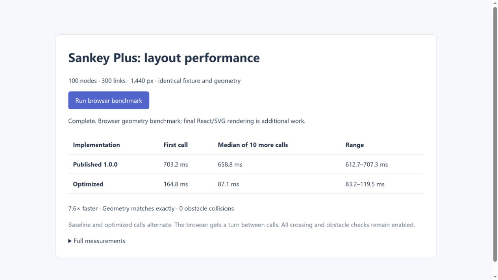

# Layout performance

[Back to README](../README.md)

Measured on 31 October 2026 on an Intel Core i7-4930K at 3.40 GHz, comparing the published 1.0.0 layout with optimization commit `afee909`. These are local measurements, not minimum hardware requirements or maximum supported graph sizes. Later routing fixes, including wrapped source port ordering, intentionally change some scene hashes; the geometry-equivalence results below refer to that optimization commit.

## What was measured

The stress fixture has four stages with 25 nodes each. Every node in the first three stages connects to four nodes in the next stage, wrapping around at the end of the column. Link amounts are 10–13. This gives 100 nodes and 300 links at a requested width of 1,440 px. It contains regular stage nodes; separate fixtures cover top/bottom nodes and wrapping.

Timing covers `resolveGraph` and `layoutGraph`, including route selection, obstacle avoidance, labels and diagnostics. Fixture creation, compilation, imports, output hashing, React rendering and browser painting are excluded. The default text measurement approximates text width; actual browser font measurement is not included in these geometry benchmarks.

## Results

Node 22.17.0, median of ten calls after the first call in each case:

| Fixture | Before | After |
| --- | ---: | ---: |
| 100 nodes / 300 links | 745.4 ms | 124.4 ms |
| Original allocation fixture, 1,440 px | 23.6 ms | 22.6 ms |
| Original allocation fixture, 360 px | 90.0 ms | 53.3 ms |
| Four-sided fixture, 1,126 px | 45.8 ms | 39.1 ms |
| Twelve wrapped destinations, 600 px | 19.2 ms | 3.0 ms |

The first stress calculation took 789.0 ms before and 230.1 ms after in these Node processes. First-call numbers include JIT warm-up and vary between runs. The non-stress fixtures use two-line node labels; the stress fixture matches its automated test's default labels.

In the desktop app's Chromium-based browser, alternating baseline and optimized stress calculations gave **658.8 ms → 87.1 ms** medians (7.6× faster). First calls took **703.2 ms → 164.8 ms**; subsequent ranges were 612.7–707.3 ms and 83.2–119.5 ms. The browser was given a turn between whole calculations; each layout itself remained synchronous.



## Profile findings and changes

The initial sampling profile showed obstacle/segment intersection checks as the largest cost, with repeated route-crossing comparisons also prominent. Optimizations preserve the routing algorithm and its budgets:

- Reject segment/rectangle pairs that cannot intersect before slab clipping; avoid iterator allocation in the clipping loop and preserve its numerical tolerances.
- Sweep overlapping segment intervals for routes that move monotonically along x, including reversed and vertical segments. Other routes retain exhaustive comparisons with bounding-box rejection.
- Reuse crossing results for unchanged route objects within one layout attempt. Replacing a route automatically invalidates the result; caches do not survive a new graph or resize.
- Reuse each link's unrelated node/label obstacles within one layout attempt.
- Use numeric visibility-grid edge keys and reuse search directions instead of creating strings and arrays for each search step.

Crossing and obstacle diagnostics remain enabled. This improvement does not come from skipping checks or reducing the routing search budget.

## Correctness and reproduction

The five benchmark fixtures produce exactly the same serialized scenes before and after optimization, including sampled paths, labels, node positions and diagnostics. An additional comparison of 40 scenes across desktop/mobile widths, top/bottom sources and destinations, and equal/unequal amounts also matched exactly. Geometry tests compare the optimized predicates with exhaustive reference checks, including reversed routes, vertical runs, endpoint contacts, near-parallel segments and epsilon-sized obstacles.

```sh
node scripts/benchmark-layout.mjs
node scripts/benchmark-layout.mjs --case stress-100-300 --runs 20
node scripts/benchmark-layout.mjs --case stress-100-300 --profile .tests/layout.cpuprofile --output .tests/layout-results.json
```

The script compiles current source before timing, shares the stress fixture with the regression test, and reports first-call, median, range, diagnostics and scene hashes. Open a `.cpuprofile` in browser developer tools for a sampling profile. Profiling adds overhead; use an unprofiled run for timings. `--modules <directory>` can select a separately compiled baseline's `model.js` and `layout.js` for comparison.

## Cooperative component layout

The component now runs the same layout iterator in main-thread chunks, targeting 8 ms between timer-task yields. It defers the first step, abandons superseded work and commits only complete scenes. Recursive width retries use the same checkpoints. Nine additional stress/full/original-fixture scenes at 360, 960 and 1440 px matched the pre-chunking implementation exactly. Tests verify timer progress during calculation, cancellation and error propagation.

`npm run stress` and `npm run benchmark` continue to drain that iterator synchronously to measure CPU work consistently; those numbers exclude scheduling delays. Chunking improves opportunities for input and painting, and can increase elapsed time. On a local Node check, three stress runs took 289–311 ms across 18–19 chunks; longest chunks were 12–17 ms. These are coarse scheduling observations, not browser render times or a hard per-chunk limit.

## Remaining limitation

Layout still executes on the main thread. A single geometry helper, input validation, custom presentation callbacks and final React/SVG rendering can block it. Coarse chunking does not guarantee a frame budget or the isolation of a worker. Graph topology, viewport size, labels and obstacle searches affect time as well as node/link counts.
